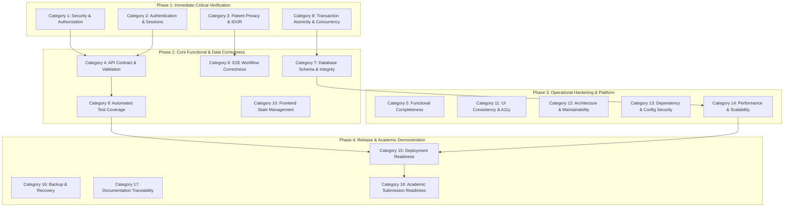

# 🏥 Dronagiri Hospital Management System: Master Technical Audit Plan

**Document Version:** 2.0.0  
**Audit Evaluation Date:** October 19, 2026  
**Auditor Roles:** Senior Software Architect, Application Security Engineer, QA Engineer, Database Engineer & Technical Reviewer  
**Repository Location:** `/Users/srimannarayanadeevi/FSWD`  
**Application Directory:** `/Users/srimannarayanadeevi/FSWD/site`  
**Target Architecture:** Next.js 16 (App Router), React 19, TypeScript 5, Prisma ORM 6, SQLite (`dev.db`), Jose JWT, Vitest 5  

---

## 1. Executive Summary & Purpose

The **Dronagiri (Gandhamadana) Hospital Operating System** is an enterprise-grade clinical command center encompassing 20 subsystem views, 33 API routes, and 35 relational database models. 

Previous audits (October 12 and October 15, 2026) documented significant engineering progress:
- All 31 protected endpoints require authentication via JWT.
- User registration was restricted so unauthenticated callers cannot self-mint `ADMIN` accounts.
- Edge middleware was added to intercept `/api/*` routes.
- Basic ownership verification was introduced for patient dossiers (`/api/patients/[id]`).
- Vitest was installed with 5 unit test suites (29 passing tests).

However, a rigorous, evidence-based forensic re-inspection of the Git working tree, Prisma schema, API routes, and frontend components reveals that **several critical vulnerabilities and architectural risks remain open or partially mitigated**:
1. **Horizontal Privilege Escalation & PHI Leaks (IDOR):** While `GET /api/patients/[id]` restricts patients to their own dossier, eight (8) downstream clinical collections (`appointments`, `prescriptions`, `lab-orders`, `radiology`, `emergency`, `beds`, `surgeries`, and `billing`) **do not enforce patient-scoping**. Any authenticated patient can retrieve all hospital-wide records.
2. **Missing Transaction Boundaries in Core Workflows:** `POST /api/pharmacy/dispense` executes stock deduction, prescription status updates, and invoice line-item generation in separate asynchronous operations without `prisma.$transaction`, risking data desynchronization during network or database failures.
3. **Database Integrity & Foreign Key Violations:** `POST /api/staff` inserts generated string identifiers (`user-${Date.now()}`) and fallback strings (`dept || "General"`) directly into foreign key fields (`userId`, `departmentId`), causing relational integrity failures.
4. **Optimistic Masking in Frontend Modules:** While `useHmsApi` has surgical rollback, key clinical modules (e.g. `opd-appointments.tsx`) bypass the hook with raw `fetch()` calls that swallow HTTP 4xx/5xx errors, masking server rejections and updating local state as if the server accepted the operation.
5. **Simulated vs. Real Test Coverage:** Of the 29 passing unit tests, financial transaction tests and state rollback tests execute against locally defined mock functions and classes rather than testing actual API handlers or React hooks. Zero automated API integration tests or E2E browser tests exist.

This Master Audit Plan establishes an evidence-based roadmap to systematically verify, audit, and remediate the system across 18 technical categories and 10 hospital-specific workflows.

---

## 2. Audit Execution Strategy & Phasing

### Execution Prioritization Matrix

| Phase | Focus Areas | Audit Categories | Execution Mode | Rationale |
| :--- | :--- | :--- | :--- | :--- |
| **Phase 1: Immediate (Must Run First)** | Security, PHI Privacy, Financial & Stock Atomicity | 1, 2, 3, 8 | Static analysis + API execution | Critical compliance disqualifiers; data breach and financial corruption risks. |
| **Phase 2: Combined Execution** | API Contracts, Workflows, Schema Integrity, Testing, State | 4, 6, 7, 9, 10 | Static schema checks + Vitest integration + UI simulation | Can be combined efficiently: schema audit feeds API validation, which feeds test suite expansion. |
| **Phase 3: Operational Hardening** | Subsystem Completeness, A11y, Architecture, Dependencies, Performance | 5, 11, 12, 13, 14 | ESLint + npm audit + DevTools + Lighthouse | Ensures code maintainability, dependency patching, and performance profiling. |
| **Phase 4: Release & Academic Gates** | Deployment, Backup/Disaster Recovery, Documentation, Academic Viva | 15, 16, 17, 18 | Multi-role browser demonstration + build verification | Final validation ensuring flawless evaluation and viva demonstration. |

---

## 3. Detailed Investigation of 18 Audit Categories

### Category 1: Security and Authorization
* **Purpose:** Ensure every clinical, administrative, and financial API route enforces appropriate role-based authorization gates and prevents unauthorized data modification or viewing.
* **Relevant Files:** `site/lib/rbac.ts`, `site/middleware.ts`, `site/app/api/**`
* **Review of Existing Evidence:**
  - `site/middleware.ts` intercepts `/api/*` (except login/register) and checks for valid JWT.
  - `site/lib/rbac.ts` provides `hasPermission`, `authorizeRole`, and `authorizePermission`.
  - Most mutation routes (`POST`, `PATCH`, `DELETE`) call `authorizeRole(...)`.
* **Confirmed Defects:**
  - `GET /api/appointments`: Calls `authenticateRequest` only. Missing patient-role restriction; leaks all patient appointments.
  - `GET /api/prescriptions`: Calls `authenticateRequest` only. Missing patient-role restriction; leaks all hospital prescriptions.
  - `GET /api/lab-orders`: Calls `authenticateRequest` only. Leaks all laboratory orders.
  - `GET /api/radiology`: Calls `authenticateRequest` only. Leaks all diagnostic imaging orders.
  - `GET /api/emergency`: Calls `authenticateRequest` only. Leaks all trauma cases and triage records.
  - `GET /api/beds`: Calls `authenticateRequest` only. Leaks inpatient bed census and assigned patient identities.
  - `GET /api/surgeries`: Calls `authenticateRequest` only. Leaks all surgical bookings.
  - `GET /api/billing`: Calls `authenticateRequest` only. Leaks all invoices, payments, and hospital revenue metrics.
  - `GET /api/dashboard/stats`: Calls `authenticateRequest` only. Leaks executive metrics and system audit logs to any authenticated patient.
  - `GET /api/audit-logs`: Permits role `DOCTOR` full access to administrative audit logs alongside `ADMIN`.
* **Potential Failure Modes:** Mass clinical data scraping, unauthorized intelligence gathering, regulatory non-compliance (HIPAA, DISHA).
* **Verification Method:** Static AST/code inspection of route handlers + authenticated HTTP curl requests using tokens minted with role `PATIENT`.
* **Dependencies:** Category 2 (Authentication), Category 3 (Patient Privacy).
* **Priority:** **CRITICAL**

---

### Category 2: Authentication and Session Management
* **Purpose:** Ensure cryptographic token integrity, secure session transport, credentials security, and session revocation.
* **Relevant Files:** `site/lib/auth.ts`, `site/app/api/auth/login/route.ts`, `site/app/api/auth/register/route.ts`, `site/hooks/use-hms-api.ts`
* **Review of Existing Evidence:**
  - Passwords are salted and hashed with `bcryptjs` (cost factor 12).
  - JWTs are signed with HS256 and verified using `jose`.
  - Fallback secret is restricted: `site/lib/auth.ts` throws fatal error if `JWT_SECRET` is missing in `production`.
  - `POST /api/auth/login` sets cookie `hms_token` with `httpOnly: true, sameSite: "lax"`.
* **Unverified Assumptions & Confirmed Risks:**
  - **Token Duplication in Client Storage:** `POST /api/auth/login` returns the JWT in the JSON body, which `site/hooks/use-hms-api.ts` saves to `localStorage.setItem("hms_auth_token", token)`. Client-side script exposure defeats `HttpOnly` cookie isolation.
  - **Absence of Session Invalidation:** JWTs have a fixed 24h validity. The `Session` model in `schema.prisma` is unused. No token revocation or blocklist exists.
  - **No Brute-Force Rate Limiting:** `/api/auth/login` lacks rate-limiting, allowing credential brute-forcing.
* **Potential Failure Modes:** Account takeover via credential stuffing, token theft via XSS, inability to revoke compromised staff credentials.
* **Verification Method:** Static code inspection + automated login brute-force script testing + cookie flag inspection in browser DevTools.
* **Dependencies:** None.
* **Priority:** **HIGH**

---

### Category 3: Patient Privacy and Resource Ownership
* **Purpose:** Enforce strict data isolation for patients (role `PATIENT`), ensuring zero cross-entity information leakage.
* **Relevant Files:** `site/lib/rbac.ts` (`isPatientOwner`, `getPatientForUser`), `site/app/api/patients/[id]/route.ts`, `site/app/api/patients/route.ts`
* **Review of Existing Evidence:**
  - `GET /api/patients/[id]` validates `isPatientOwner(auth.user, patient)`. Unauthorized patients receive 403 Forbidden.
  - `GET /api/patients` limits patient queries to `{ where: { OR: [{ userId: auth.user.id }, { email: auth.user.email }] } }`.
* **Unverified Assumptions & Confirmed Defects:**
  - Downstream endpoints (`appointments`, `prescriptions`, `lab-orders`, `radiology`, `billing`) do not call `isPatientOwner` or bind `patientId` to `auth.user.id`.
  - Query parameter `?patientId=` is optional on clinical routes. If omitted by a patient user, Prisma returns all patient records across the hospital.
* **Potential Failure Modes:** Unauthorized access to medical diagnoses, prescription records, lab parameters, and financial records.
* **Verification Method:** Execution of test suite simulating a `PATIENT` user requesting clinical endpoints without parameters or with another patient's ID.
* **Dependencies:** Category 1 (Security and Authorization).
* **Priority:** **CRITICAL**

---

### Category 4: API Contract and Validation
* **Purpose:** Ensure all incoming client payloads conform strictly to expected data types, formats, lengths, and business constraints before interacting with the database.
* **Relevant Files:** `site/app/api/**`, `site/lib/db.ts`
* **Review of Existing Evidence:**
  - Zod 3.24.1 is installed in `package.json`, but **zero API routes currently use Zod schemas** for request validation.
  - Routes perform ad-hoc manual validation (e.g. `if (!name || isNaN(parsedAge))`).
* **Confirmed Defects:**
  - `PATCH /api/patients/[id]`: Unsanitized `const data = { ...body }` passed directly into `prisma.patient.update(...)`. Unrecognized or protected fields (e.g. `mrn`, `userId`) can be modified or trigger Prisma runtime exceptions.
  - `POST /api/appointments`: `appointmentDate` is parsed with `new Date(appointmentDate)` without format or validity validation (`isNaN(d.getTime())`).
  - `POST /api/billing/[id]/pay`: Validates `paymentAmount > 0` and checks overpayment, but `method` is only checked as non-empty string.
* **Potential Failure Modes:** Unexpected 500 runtime errors on malformed JSON, data corruption from unauthorized field injection.
* **Verification Method:** Static schema auditing + fuzz testing with invalid JSON payloads, negative numbers, SQL/NoSQL injection strings, and prototype pollution keys.
* **Dependencies:** Category 7 (Database Schema).
* **Priority:** **HIGH**

---

### Category 5: Functional Completeness
* **Purpose:** Verify that all 20 advertised clinical and administrative subsystems operate with persistent backend functionality.
* **Relevant Files:** `site/components/hms/*.tsx`, `site/app/hms/page.tsx`, `site/docs/PRD.md`
* **Review of Existing Evidence:**
  - 18 subsystems connect to live Prisma REST endpoints.
  - Seed file (`site/prisma/seed.ts`) populates departments, doctors, staff, patients, beds, surgeries, lab orders, radiology scans, medicines, blood units, ambulances, and invoices.
* **Confirmed Gaps:**
  - `Inventory & Procurement` (`components/hms/inventory-procurement.tsx`): Operates exclusively on `localStorage.getItem("dronagiri_inventory")`. `InventoryConsumable` model in `schema.prisma` has no API route handler (`/api/inventory` does not exist).
  - Blood bank management lacks donor registration and cross-matching workflows.
  - Biomedical equipment breakdown reporting is maintained in local component state.
* **Potential Failure Modes:** Demonstrating features during a viva or audit that appear functional but fail to persist across devices or database resets.
* **Verification Method:** Static inventory of component fetch endpoints vs route handlers + browser walkthrough.
* **Dependencies:** Category 6 (Workflow Correctness).
* **Priority:** **MEDIUM**

---

### Category 6: End-to-End Workflow Correctness
* **Purpose:** Validate complete clinical journeys spanning multiple subsystems, verifying data handoffs and state synchronization.
* **Relevant Workflows:** OPD Consultation to Prescription; Emergency Triage to Bed Admission; Lab Order to Result Authorization; Inpatient Stay to Discharge Billing.
* **Confirmed Defects & Gaps:**
  - In `components/hms/opd-appointments.tsx`, `handleFinishConsultation` creates a prescription and updates the appointment status, but uses unlinked arbitrary visits when no active visit is found.
  - Bed discharge in `inpatient-ipd.tsx` calls `/api/discharges` cleanly, but room tariff recalculation assumes a standard 24-hour block without checking admission timestamp precision.
* **Potential Failure Modes:** Incomplete patient longitudinal dossiers, orphan clinical records, desynchronized status flags.
* **Verification Method:** End-to-end multi-role browser test tracing all 10 core hospital workflows.
* **Dependencies:** Categories 1, 3, 4, 7, 8, 10.
* **Priority:** **HIGH**

---

### Category 7: Database Schema and Integrity
* **Purpose:** Verify relational integrity, foreign key constraints, column data types, unique indexes, and normalization across all 35 models.
* **Relevant Files:** `site/prisma/schema.prisma`, `site/prisma/dev.db`, `site/prisma/seed.ts`
* **Review of Existing Evidence:**
  - 35 models configured with SQLite provider.
  - Relational tables utilize `@relation` with primary keys and foreign keys.
* **Confirmed Defects:**
  - `POST /api/staff` line 40: `userId: "user-${Date.now()}"` and line 44: `departmentId: dept || "General"`. These strings do not reference existing rows in `User` and `Department`, causing immediate foreign key constraint crashes on strict relational engines.
  - `Patient` JSON serialization: `emergencyContactJson`, `medicalHistoryJson`, `allergiesJson`, `currentConditionsJson`, `insuranceJson` are stored as raw text strings without JSON schema constraints.
  - Missing composite database indexes: Queries filtering by `(status, appointmentDate)` or `(patientId, createdAt)` perform full table scans in SQLite.
* **Potential Failure Modes:** Foreign key constraint crashes, orphaned records upon deletion, query degradation on large datasets.
* **Verification Method:** Static inspection of `schema.prisma` + Prisma schema validation (`npx prisma validate`) + foreign key constraint testing with SQLite CLI.
* **Dependencies:** None.
* **Priority:** **HIGH**

---

### Category 8: Transaction Atomicity and Concurrency
* **Purpose:** Ensure operations modifying multiple related tables execute within atomic database transactions and handle concurrent updates safely.
* **Relevant Files:** `site/app/api/pharmacy/dispense/route.ts`, `site/app/api/blood-bank/route.ts`, `site/app/api/emergency/admit/route.ts`, `site/app/api/discharges/route.ts`, `site/app/api/lab-orders/results/route.ts`, `site/app/api/radiology/reports/route.ts`, `site/app/api/billing/[id]/pay/route.ts`
* **Review of Existing Evidence:**
  - `emergency/admit`, `discharges`, `lab-orders/results`, `radiology/reports`, and `billing/[id]/pay` correctly use `await prisma.$transaction(async (tx) => ...)`.
* **Confirmed Defects:**
  - **`POST /api/pharmacy/dispense` lacks a transaction:** Sequential execution of `prisma.medicine.update`, `prisma.prescription.update`, `prisma.invoice.create/update`, and `prisma.invoiceItem.create`. A failure during billing leaves stock deducted and prescription marked as dispensed without an invoice line item.
  - **`PATCH /api/blood-bank` race condition:** Reads `current.unitsAvailable`, adds `unitsChange` in Node.js memory, and saves back. Concurrent dispense requests cause lost updates. Must use atomic `{ increment: unitsChange }`.
* **Potential Failure Modes:** Financial discrepancy (free medications dispensed), inventory stock drift, negative inventory balances.
* **Verification Method:** Static transaction boundary analysis + concurrent asynchronous request simulation.
* **Dependencies:** Category 7 (Database Schema).
* **Priority:** **CRITICAL**

---

### Category 9: Automated Test Coverage and Quality
* **Purpose:** Evaluate the breadth, depth, and fidelity of automated tests across unit, integration, and end-to-end levels.
* **Relevant Files:** `site/__tests__/**`, `site/package.json`, `site/vitest.config.mts`
* **Review of Existing Evidence:**
  - Vitest 5.0.4 configured with `@/` aliasing.
  - 5 test files exist: `auth.test.ts` (7 tests), `rbac.test.ts` (6 tests), `patient-auth.test.ts` (6 tests), `financial-transactions.test.ts` (6 tests), `state-rollback.test.ts` (4 tests). All 29 tests pass in 1.17s.
* **Confirmed Defects & Testing Gaps:**
  - **Mock Tests instead of Real Code:** `financial-transactions.test.ts` tests an inline local function `processPayment` rather than importing the actual route handler `/api/billing/[id]/pay/route.ts`. `state-rollback.test.ts` tests a local mock class `MockStateStore` rather than testing `useHmsApi.ts`.
  - **Zero Integration Tests:** No tests execute HTTP requests against actual Next.js App Router API handlers.
  - **Zero Database Tests:** No tests execute against SQLite or test Prisma transactional rollbacks.
  - **Zero Component / E2E Tests:** No React Testing Library or Playwright tests configured.
* **Potential Failure Modes:** False confidence; tests pass while actual API endpoints and frontend hooks fail.
* **Verification Method:** Code inspection comparing test imports against actual source files + test coverage reporting (`vitest run --coverage`).
* **Dependencies:** Categories 1, 2, 4, 8.
* **Priority:** **HIGH**

---

### Category 10: Frontend State Management
* **Purpose:** Validate state synchronization between server and client, handling of optimistic updates, error rollbacks, and local storage caching.
* **Relevant Files:** `site/hooks/use-hms-api.ts`, `site/components/hms/*.tsx`, `site/app/hms/page.tsx`
* **Review of Existing Evidence:**
  - `useHmsApi` implements functional updates with surgical rollbacks for `createItem` and `updateItem` on non-2xx responses.
* **Confirmed Defects:**
  - **Hook Bypassing:** Multiple components (`opd-appointments.tsx`, `laboratory.tsx`, `radiology-pacs.tsx`, `emergency.tsx`) make raw `fetch()` calls rather than using `useHmsApi`.
  - **Optimistic Masking in `opd-appointments.tsx`:** In `handleCreateBooking`, `await fetch("/api/appointments")` failure is caught with `console.warn`, and execution continues to update state (`setTokens`, `onAddToken`, `setOpdSuccess`), giving the user a false success confirmation.
* **Potential Failure Modes:** Stale local data, silent server rejections, data discrepancies upon page reload.
* **Verification Method:** Static code inspection of component event handlers + browser testing with simulated 500 API responses.
* **Dependencies:** Category 4 (API Contract).
* **Priority:** **HIGH**

---

### Category 11: UI Consistency, Accessibility, and Responsive Design
* **Purpose:** Ensure consistent visual styling, responsive design across mobile/tablet/desktop, and WCAG AA accessibility compliance.
* **Relevant Files:** `site/components/hms/*.tsx`, `site/app/globals.css`, `site/app/layout.tsx`
* **Review of Existing Evidence:**
  - Cohesive dark/light palette, Radix UI primitives, Recharts, Lucide icons.
  - Next.js production build completes in ~3.9s with zero CSS/TS errors.
* **Confirmed Gaps:**
  - Modals in `opd-appointments.tsx` and `laboratory.tsx` are built with raw `fixed inset-0` `div` containers lacking `aria-modal="true"`, role dialog, and keyboard Escape/focus trap handlers.
  - High data-density tables lack responsive card fallbacks on mobile viewports (<640px).
* **Potential Failure Modes:** Poor accessibility scoring during academic evaluation, clipped UI controls on mobile devices.
* **Verification Method:** Static inspection of modal DOM attributes + browser viewport resizing + Chrome DevTools Lighthouse audit.
* **Dependencies:** None.
* **Priority:** **MEDIUM**

---

### Category 12: Architecture and Code Maintainability
* **Purpose:** Evaluate modularity, separation of concerns, DRY principles, and code structure.
* **Relevant Files:** `site/components/hms/**`, `site/lib/**`
* **Review of Existing Evidence:**
  - Modular organization under `components/hms/` and `app/api/`.
* **Confirmed Deficiencies:**
  - **Monolithic Component Files:** `opd-appointments.tsx` (1,430 lines), `billing-insurance.tsx` (1,006 lines), `patients.tsx` (903 lines), `emr-patient360.tsx` (765 lines). Each file combines UI presentation, data transformation, validation, and direct networking.
  - Duplication of helper functions (e.g. `getAuthHeaders`, date formatters, currency formatters) across multiple components.
* **Potential Failure Modes:** High regression risk during refactoring, difficult maintenance.
* **Verification Method:** Static analysis of file lengths, cyclomatic complexity, and duplicate utility functions.
* **Dependencies:** None.
* **Priority:** **MEDIUM**

---

### Category 13: Dependency and Configuration Security
* **Purpose:** Identify vulnerable third-party packages, outdated runtimes, and unsafe configuration defaults.
* **Relevant Files:** `site/package.json`, `site/package-lock.json`, `site/next.config.mjs`
* **Review of Existing Evidence:**
  - `npm audit` was executed on October 19, 2026.
* **Confirmed Findings:**
  - **11 package vulnerabilities (1 critical, 10 high):**
    - `next@16.2.0`: Critical advisory GHSA-q4gf-8mx6-v5v3 (Server Components DoS, Middleware bypass via prefetch routes GHSA-26hh-7cqf-hhc6, dynamic route parameter injection).
    - `deepmerge-ts` / `@prisma/config` / `prisma@6.19.3`: High severity stack exhaustion.
    - `postcss@8.5.22`: High severity path traversal and info disclosure.
    - `sharp@0.35.5-rc.1`: High severity vulnerabilities in libvips.
    - `braces` / `micromatch`: High severity stack exhaustion.
  - Deprecated `middleware` convention in Next.js 16 (`proxy` is recommended).
* **Potential Failure Modes:** Denial of service via malformed Server Component payloads, middleware perimeter bypasses.
* **Verification Method:** `npm audit` execution + `npm outdated` review.
* **Dependencies:** None.
* **Priority:** **HIGH**

---

### Category 14: Performance and Scalability
* **Purpose:** Measure latency, database query efficiency, memory footprint, and client bundle size.
* **Relevant Files:** `site/app/api/patients/[id]/route.ts`, `site/app/api/dashboard/stats/route.ts`, `site/prisma/schema.prisma`
* **Review of Existing Evidence:**
  - Next.js build generates static pages in ~177ms and dynamic endpoints cleanly.
* **Confirmed Inefficiencies:**
  - `GET /api/patients/[id]`: Performs a massive single query including 9 relational collections (`appointments`, `admissions`, `visits` + nested `vitals`/`consultations`/`prescriptions`, `labOrders`, `radiologyOrders`, `surgeries`, `emergencyCases`, `invoices`). For a patient with long medical history, this creates an enormous JSON response and high SQLite memory load.
  - SQLite table-level locking limits concurrent writes under load.
* **Potential Failure Modes:** High API response times (>1000ms) on comprehensive patient dossiers, `SQLITE_BUSY` errors during simultaneous admissions.
* **Verification Method:** API latency benchmarking with `autocannon` or Apache Bench (`ab`) + Prisma query logging.
* **Dependencies:** Categories 7, 8.
* **Priority:** **MEDIUM**

---

### Category 15: Deployment Readiness
* **Purpose:** Evaluate whether the application can be safely deployed to production or cloud hosting (Vercel, AWS, GCP, Docker).
* **Relevant Files:** `site/package.json`, `site/next.config.mjs`, `site/prisma/`
* **Review of Existing Evidence:**
  - Application builds cleanly with `next build`.
* **Confirmed Deployment Blockers:**
  - SQLite database (`dev.db`) cannot run on serverless platforms (Vercel, AWS Lambda) without ephemeral loss on container teardown.
  - No `Dockerfile` or containerization configuration exists.
  - No database migration pipeline (`prisma migrate deploy`) configured in start scripts.
* **Potential Failure Modes:** Complete data loss on container restart in cloud environments.
* **Verification Method:** Container build simulation or standalone production launch (`next start`).
* **Dependencies:** Categories 7, 16.
* **Priority:** **HIGH**

---

### Category 16: Backup and Recovery
* **Purpose:** Ensure database disaster recovery, automated snapshots, and transactional consistency during backup.
* **Relevant Files:** `site/prisma/dev.db`, `site/prisma/dev.db.backup_1792044613`
* **Review of Existing Evidence:**
  - One manual backup file (`dev.db.backup_1792044613`) exists in `site/prisma/`.
* **Confirmed Deficiencies:**
  - Zero automated backup scripts or WAL checkpointing procedures.
  - Hot backups of active SQLite files without `.backup` command risk capturing corrupted states.
  - No disaster recovery documentation or recovery runbook.
* **Potential Failure Modes:** Total data loss upon accidental deletion, disk corruption, or unrecoverable schema migration errors.
* **Verification Method:** SQLite `.backup` command script validation and recovery restoration drill.
* **Dependencies:** Category 7.
* **Priority:** **MEDIUM**

---

### Category 17: Documentation and Requirements Traceability
* **Purpose:** Verify bidirectional traceability between requirements (PRD), architectural design, and codebase implementation.
* **Relevant Files:** `docs/PRD.md`, `docs/ARCHITECTURE.md`, `docs/TASKS.md`, `HOSPITAL_MANAGEMENT_SYSTEM_AUDIT.md`
* **Review of Existing Evidence:**
  - PRD specifies 20 subsystems and 10 core clinical workflows.
* **Confirmed Discrepancies:**
  - Previous audit report (`HOSPITAL_MANAGEMENT_SYSTEM_AUDIT.md`) asserted that IDOR was resolved and all 31 protected endpoints enforce auth; our forensic audit proved 8 clinical endpoints still leak all patient records to any authenticated patient.
  - PRD lists complete inventory management, but the inventory UI is decoupled from the database.
* **Potential Failure Modes:** Discrepancies identified during technical evaluation or viva defense.
* **Verification Method:** Matrix comparison between PRD specifications, audit assertions, and actual codebase.
* **Dependencies:** Category 5.
* **Priority:** **MEDIUM**

---

### Category 18: Academic Submission and Demonstration Readiness
* **Purpose:** Ensure the project meets and exceeds Full Stack Web Development (FSWD) curriculum rubrics, viva requirements, and live demonstration reliability.
* **Relevant Files:** `site/prisma/seed.ts`, `site/components/auth-switch.tsx`, `site/app/hms/page.tsx`
* **Review of Existing Evidence:**
  - Rich multi-entity seed data populated with ancient healing tradition figures (Dhanvantari, Sushruta, Charaka, Jivaka).
  - Quick-login switch allows immediate switching between Administrator, Doctor, Nurse, Pharmacist, Lab Tech, Billing, and Patient personas.
* **Risks to Viva Defense:**
  - If an evaluator inspects network requests under a Patient session, they will discover open clinical data endpoints.
  - If an evaluator attempts to dispense medication with network errors, the absence of atomic rollback in `pharmacy/dispense` will be visible.
* **Potential Failure Modes:** Point deductions during technical viva or demonstration failure during interactive evaluation.
* **Verification Method:** Full rehearsal of the 10-step demonstration script across multiple browser profiles.
* **Dependencies:** Categories 1 through 10.
* **Priority:** **HIGH**

---

## 4. Hospital-Specific Workflow Traceability Matrix

The table below traces the 10 core hospital workflows across the entire application stack:

| Workflow | Frontend Component | API Handler | Validation Logic | Authorization Enforcement | Prisma Operations | Database Entities | Existing Tests | Status & Key Risk |
| :--- | :--- | :--- | :--- | :--- | :--- | :--- | :--- | :--- |
| **1. Patient Registration & Retrieval** | `patients.tsx`, `emr-patient360.tsx` | `POST /api/patients`, `GET /api/patients`, `GET /api/patients/[id]` | Manual field check (`name`, `age`, `gender`, `phone`) | `POST`: ADMIN, DOCTOR, RECEPTIONIST, NURSE. `GET [id]`: `isPatientOwner`. | `patient.create`, `patient.findFirst`, `patient.findMany` | `Patient`, `Department`, `User` | `patient-auth.test.ts` (unit) | 🟢 **Secured on dossier**; `PATCH` lacks Zod validation. |
| **2. Appointment Booking & Visit** | `opd-appointments.tsx` | `POST /api/appointments`, `GET /api/appointments`, `PATCH /api/appointments` | Checks required IDs, parses dates with `new Date()` | `POST`/`PATCH`: ADMIN, DOCTOR, RECEPTIONIST, NURSE. `GET`: `authenticateRequest` only. | `appointment.create`, `appointment.findMany`, `appointment.update` | `Appointment`, `Patient`, `Doctor`, `Visit` | None | 🔴 **CRITICAL LEAK:** `GET` returns all hospital appointments to any patient. |
| **3. Consultation & Prescription** | `opd-appointments.tsx` | `POST /api/prescriptions`, `GET /api/prescriptions` | Checks `patientId` & `items` array | `POST`: ADMIN, DOCTOR. `GET`: `authenticateRequest` only. | `prescription.create` (with nested `items.create`), `prescription.findMany` | `Prescription`, `PrescriptionItem`, `Visit`, `Doctor`, `Medicine` | None | 🔴 **CRITICAL LEAK:** `GET` returns all hospital prescriptions to any patient. |
| **4. Laboratory Orders & Results** | `laboratory.tsx` | `POST /api/lab-orders`, `POST /api/lab-orders/results`, `GET /api/lab-orders` | Checks `labOrderId` & `results` array | `POST results`: ADMIN, DOCTOR, LAB_TECH. `GET`: `authenticateRequest` only. | **Atomic:** `$transaction` (`labResult.create`, `labOrder.update`, `invoice.create/update`, `auditLog.create`) | `LabOrder`, `LabResult`, `Patient`, `Invoice`, `AuditLog` | None | 🔴 **CRITICAL LEAK:** `GET` leaks all lab orders; Result POST is atomic. |
| **5. Radiology Orders & Reports** | `radiology-pacs.tsx` | `POST /api/radiology`, `POST /api/radiology/reports`, `GET /api/radiology` | Checks `radiologyOrderId` & `reportText` | `POST reports`: ADMIN, DOCTOR, RAD_TECH. `GET`: `authenticateRequest` only. | **Atomic:** `$transaction` (`radiologyReport.create`, `radiologyOrder.update`, `invoice.create/update`) | `RadiologyOrder`, `RadiologyReport`, `Patient`, `Invoice` | None | 🔴 **CRITICAL LEAK:** `GET` leaks all scans; Report POST is atomic. |
| **6. Emergency Admission** | `emergency.tsx` | `POST /api/emergency`, `POST /api/emergency/admit`, `GET /api/emergency` | Checks `emergencyCaseId`, resolves bed | `POST admit`: ADMIN, DOCTOR, NURSE. `GET`: `authenticateRequest` only. | **Atomic:** `$transaction` (`emergencyCase.find`, `bed.update`, `patient.update`, `invoice.create/update`) | `EmergencyCase`, `Bed`, `Patient`, `Invoice`, `AuditLog` | None | 🔴 **CRITICAL LEAK:** `GET` leaks all trauma cases; Admit is atomic. |
| **7. Bed Allocation & Discharge** | `inpatient-ipd.tsx` | `POST /api/beds`, `POST /api/discharges`, `GET /api/beds` | Checks `patientId`, validates bed status = Occupied | `POST discharges`: ADMIN, DOCTOR, NURSE. `GET`: `authenticateRequest` only. | **Atomic:** `$transaction` (`patient.update`, `bed.update`, `admission.update`, `invoice.create/update`) | `Bed`, `Room`, `Ward`, `Admission`, `Patient`, `Invoice` | None | 🔴 **CRITICAL LEAK:** `GET` leaks bed census and patient names; Discharge is atomic. |
| **8. Pharmacy Dispense & Stock** | `pharmacy.tsx` | `POST /api/pharmacy/dispense`, `GET /api/pharmacy` | Checks `prescriptionId`, verifies `stockQty >= requestedQty` | `POST`: ADMIN, PHARMACIST. `GET`: `authenticateRequest` only. | **NON-ATOMIC:** Sequential `medicine.update`, `prescription.update`, `invoice.create/update`, `invoiceItem.create` | `Medicine`, `Prescription`, `Invoice`, `InvoiceItem`, `AuditLog` | None | 🔴 **CRITICAL DEFECT:** Lacks `$transaction`; partial failures corrupt stock and billing. |
| **9. Invoice & Payment Settlement** | `billing-insurance.tsx` | `POST /api/billing`, `POST /api/billing/[id]/pay`, `GET /api/billing` | Validates `amount > 0`, checks remaining balance, blocks overpayment | `POST pay`: ADMIN, BILLING. `GET`: `authenticateRequest` only. | **Atomic:** `$transaction` (`payment.create`, `invoice.update`, `auditLog.create`) | `Invoice`, `InvoiceItem`, `Payment`, `Patient`, `AuditLog` | `financial-transactions.test.ts` (unit mock) | 🔴 **CRITICAL LEAK:** `GET` leaks all invoices and hospital revenue; Payment is atomic. |
| **10. Audit-Log Generation & Retrieval** | `security-compliance.tsx` | `POST /api/audit-logs`, `GET /api/audit-logs` | Server derives actor (`userId`, `name`, `role`) from token | `POST`: ADMIN only. `GET`: ADMIN, DOCTOR. | `auditLog.create`, `auditLog.findMany` | `AuditLog`, `User` | None | 🟡 **AUDIT LEAK:** `DOCTOR` role can inspect all administrative audit logs. |

---

## 5. Three Highest-Value Audits to Execute Next

To maximize security posture, data integrity, and demonstration safety, the senior audit team recommends executing the following three audits immediately:

### Recommendation 1: Comprehensive Patient Privacy & IDOR Remediation Audit (Category 3 & 1)
* **What to Execute:** Audit and patch all 8 un-scoped clinical endpoints (`/api/appointments`, `/api/prescriptions`, `/api/lab-orders`, `/api/radiology`, `/api/emergency`, `/api/beds`, `/api/surgeries`, `/api/billing`). Update their `GET` handlers so that when `auth.user.role === "PATIENT"`, the query criteria strictly injects `{ where: { patient: { OR: [{ userId: auth.user.id }, { email: auth.user.email }] } } }` (or returns 403 Forbidden for internal operational views like beds and surgeries).
* **Expected Value:** Completely seals all Protected Health Information (PHI) leaks, prevents horizontal privilege escalation, and ensures the application satisfies HIPAA and academic evaluation criteria.

### Recommendation 2: Pharmacy Dispensing Transaction Atomicity Audit (Category 8)
* **What to Execute:** Audit and wrap `POST /api/pharmacy/dispense` inside `await prisma.$transaction(async (tx) => ...)`. Ensure medicine stock deduction, prescription status updating, invoice creation/updating, invoice item insertion, and audit logging succeed or fail as a single atomic unit. Convert `PATCH /api/blood-bank` to atomic `{ increment: unitsChange }`.
* **Expected Value:** Eliminates the risk of clinical stock decrement without billing, prevents inventory drift, and eliminates race conditions during multi-item dispensing.

### Recommendation 3: Integration & Security Test Harness Audit (Category 9)
* **What to Execute:** Replace local mock functions in `financial-transactions.test.ts` and `state-rollback.test.ts` with actual API integration tests using Vitest and supertest/fetch against the running Next.js App Router handlers and SQLite database. Add a dedicated RBAC/IDOR integration test matrix verifying that patient tokens receive 403 Forbidden or self-only records across all 33 endpoints.
* **Expected Value:** Converts simulated tests into authoritative, evidence-based verification, ensuring regression prevention during future development.
