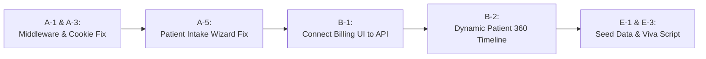

# 🗺️ Hospital Management System — Prioritized Implementation Roadmap
## Project: Dronagiri (Gandhamadana) Hospital Operating System

**Document Version:** 1.0.0  
**Audit Reference:** October 12, 2026 Technical Audit  
**Target Submission:** Full Stack Development Course Project / Final Examination & Viva  
**Application Root:** `/Users/srimannarayanadeevi/FSWD/site`

---

## 1. Executive Roadmap Strategy

The technical audit identified that while Dronagiri possesses an exceptionally broad visual layout (20 subsystem UI modules) and a rich Prisma schema (33 relational models), a significant number of components operate on optimistic local memory or `localStorage` caches rather than completing live server transactions. Additionally, 14 out of 33 API endpoints lack server-side authentication or authorization checks.

This roadmap follows a phased remediation trajectory engineered to transition the application from an optimistic academic prototype into a production-grade, verifiable full-stack demonstration.

### Planning Assumptions & Effort Metrics
- **Effort Estimates:** Expressed in hours (h) or days (d), based on a dedicated senior developer working continuously.
- **Scope Target:** Optimized for academic viva excellence, live clinical demonstration reliability, and defense against examiner cross-examination.
- **Environment:** Node.js 22+, Next.js 16.2 App Router, Prisma ORM 6.19, SQLite local prototyping.

---

## 2. Phase-by-Phase Action Plan

### Phase A: Fix Existing Deficiencies & Security Hardening (Immediate Priority)
*Goal: Secure open endpoints, eliminate IDOR vulnerabilities, and fix decoupled data flows.*

| Task ID | Task Description | Priority | Dependencies | Estimated Effort | Expected Result | Completion Criteria |
| :--- | :--- | :--- | :--- | :--- | :--- | :--- |
| **A-1** | **Global Middleware & JWT Verification** Create `site/middleware.ts` to intercept `/api/*` routes and validate session cookies/Bearer tokens via `jose`. | Critical | None | 4 hours | Unauthorized requests to protected routes are rejected at edge with 401. | Unauthenticated requests to `/api/patients`, `/api/billing`, `/api/beds` return `401 Unauthorized`. |
| **A-2** | **Lock Down Open Mutating Endpoints** Apply `authorizeRole` and `authenticateRequest` across all 14 unprotected routes (`/api/patients/[id]`, `/api/beds`, `/api/surgeries`, `/api/prescriptions`, `/api/discharges`, `/api/equipment`, `/api/staff`, `/api/radiology/reports`, `/api/billing/[id]/pay`). | Critical | A-1 | 5 hours | Server-side RBAC enforced; patients/staff cannot alter records belonging to higher roles. | Verified tests asserting `403 Forbidden` when non-authorized roles invoke protected mutation handlers. |
| **A-3** | **Secure Open User Registration & Cookie Flags** Update `api/auth/register` to prevent unauthenticated `role: "ADMIN"` creation. Set `httpOnly: true` on auth cookies in `api/auth/login`. | Critical | None | 2 hours | Public registration cannot escalate privileges; JWT tokens inaccessible to XSS scripts. | Cookie inspector shows `HttpOnly` flag enabled; register endpoint rejects role tampering. |
| **A-4** | **Standardize Frontend API Client Headers** Update all component `fetch()` calls in `site/components/hms/*` to automatically inject `Authorization: Bearer <token>` via a unified API helper. | High | A-1 | 4 hours | Eliminates session drops when cookies are disabled or cross-origin headers are required. | Zero `401 Unauthorized` responses in browser console during active clinical sessions. |
| **A-5** | **Fix Patient Registration Data Truncation** Update `handleAddPatient` in `app/hms/page.tsx:L160-169` to forward all 6 steps of wizard data (allergies, medical history, emergency contacts, insurance). | High | None | 2 hours | Full demographic and clinical profile persisted to SQLite `Patient` table. | New patient created via wizard retains insurance and allergy records in DB upon inspection. |

---

### Phase B: Complete Core Clinical Workflows (Functional Closure)
*Goal: Connect decoupled UI forms to real database transactions and verify end-to-end data persistence.*

| Task ID | Task Description | Priority | Dependencies | Estimated Effort | Expected Result | Completion Criteria |
| :--- | :--- | :--- | :--- | :--- | :--- | :--- |
| **B-1** | **Connect Billing UI to Database Handlers** Update `components/hms/billing-insurance.tsx` to call `POST /api/billing`. Add "Record Payment" modal calling `POST /api/billing/[id]/pay`. | High | A-2 | 5 hours | Invoices generated from UI persist to DB; payments update status from `Outstanding` to `Paid`. | Invoice records appear in `Invoice` table with linked `InvoiceItem` and `Payment` records. |
| **B-2** | **Dynamic EMR / Patient 360 Timeline** Refactor `components/hms/emr-patient360.tsx` to replace static `mockTimeline` with dynamic timeline synthesized from `/api/patients/[id]`. | High | A-2 | 4 hours | Patient 360 view reflects real patient vitals, admissions, prescriptions, and lab tests. | Adding an OPD appointment or lab test immediately reflects in the patient's EMR timeline. |
| **B-3** | **Persist WHO Surgical Checklists** Add `PATCH /api/surgeries/[id]` endpoint. Update `components/hms/operation-theatre.tsx` to persist checklist toggles and stage progressions. | Medium | A-2 | 3 hours | Surgical safety checklists persist across page refreshes. | Toggling "Consent Signed" or "Site Marked" updates `preOpChecklistJson` in SQLite. |
| **B-4** | **Record Inpatient Admissions in Schema** Update `/api/beds` allocation and `/api/emergency/admit` to insert corresponding `Admission` records into `Admission` table. | Medium | A-2 | 3 hours | Inpatient census history and admission durations are tracked properly. | `prisma.admission.count()` increases when a patient is admitted from Emergency or Bed Matrix. |
| **B-5** | **Live Audit Log Viewer Integration** Refactor `components/hms/security-compliance.tsx` to fetch `/api/audit-logs` instead of reading `INITIAL_AUDIT_LOGS` from `localStorage`. | Medium | A-2 | 2 hours | Compliance view displays real system actions performed by doctors, nurses, and admins. | Performing an admission or prescription immediately appears at top of audit log table. |

---

### Phase C: Polish Usability, Validation & State Feedback
*Goal: Prevent silent failures, add loading skeletons, and validate form inputs.*

| Task ID | Task Description | Priority | Dependencies | Estimated Effort | Expected Result | Completion Criteria |
| :--- | :--- | :--- | :--- | :--- | :--- | :--- |
| **C-1** | **Zod Schema Payload Validation** Implement runtime `zod` schemas on all API POST/PATCH handlers to validate request payloads before Prisma execution. | Medium | A-2 | 6 hours | Malformed or negative inputs (e.g. invalid blood units, negative billing amounts) rejected with clear 400 errors. | Automated schema validation rejects invalid payloads with descriptive JSON error messages. |
| **C-2** | **Global Toast & Loading State Unification** Replace ad-hoc `alert()` and silent `console.warn()` with `sonner` toasts across all clinical views. | Medium | None | 4 hours | Clinical actions provide immediate visual confirmation and actionable error feedback. | Toasts fire consistently on success/failure for bed moves, triage admissions, and Rx dispenses. |
| **C-3** | **Clean Landing Page Architecture** Refactor `app/page.tsx` to remove legacy scaffolding artifacts (`AgenticPage`, unused agent dependencies) and present a unified HMS theme. | Low | None | 3 hours | Cohesive product presentation aligned with Dronagiri Hospital Operating System. | Zero unused agent imports or confusing multi-agent copy on public landing page. |
| **C-4** | **Search, Filtering & Pagination Polish** Add server-side pagination and debounced search across Patient Directory, Pharmacy Inventory, and Billing Invoices. | Low | None | 4 hours | High-volume lists load smoothly without freezing browser threads. | Search input handles 100+ simulated patients with $< 100\text{ms}$ UI response. |

---

### Phase D: Automated Testing & Reliability Suite
*Goal: Provide automated verification for academic grading, regression testing, and CI/CD.*

| Task ID | Task Description | Priority | Dependencies | Estimated Effort | Expected Result | Completion Criteria |
| :--- | :--- | :--- | :--- | :--- | :--- | :--- |
| **D-1** | **Install & Configure Testing Framework** Install Vitest, `@testing-library/react`, and configure `vitest.config.ts`. | High | None | 2 hours | Test runner configured and runnable via `npm test`. | Running `npm test` executes tests in $< 5\text{s}$. |
| **D-2** | **Author Authentication & RBAC Unit Tests** Write unit tests covering password hashing, JWT generation/expiration, and RBAC matrix permissions. | High | D-1, A-1 | 4 hours | Validates that unauthorized roles cannot access clinical data. | Minimum 15 automated test cases passing with 100% assertion pass rate. |
| **D-3** | **Author Core Transaction Integration Tests** Write integration tests for Emergency Admission (`/api/emergency/admit`) and Inpatient Discharge (`/api/discharges`). | High | D-1, B-4 | 5 hours | Atomic Prisma transactions verified against SQLite test database. | Tests confirm bed release, patient status change, invoice item creation, and audit logging execute atomically. |

---

### Phase E: Viva Preparation, Deployment & Documentation
*Goal: Ensure seamless presentation, zero-setup demonstration, and complete academic submission.*

| Task ID | Task Description | Priority | Dependencies | Estimated Effort | Expected Result | Completion Criteria |
| :--- | :--- | :--- | :--- | :--- | :--- | :--- |
| **E-1** | **Clean Database Seed Script** Update `prisma/seed.ts` to ensure all 33 models have coherent relational seed records (including `Consultation`, `Admission`, `InventoryConsumable`). | Medium | B-4 | 3 hours | Running `npx prisma db seed` produces a fully populated hospital census ready for demo. | Zero empty clinical tables; every tab in HMS displays coherent demonstration data. |
| **E-2** | **Production Environment Setup (.env.example)** Create `site/.env.example` documenting all configuration keys (`DATABASE_URL`, `JWT_SECRET`, `NODE_ENV`). | Low | None | 1 hour | Clear deployment and evaluation instructions. | Reviewer can clone repo, copy `.env.example`, run `npm run dev`, and evaluate immediately. |
| **E-3** | **Viva Demonstration Script & Walkthrough** Author step-by-step viva presentation guide detailing the 5 golden clinical workflows for live demonstration. | High | Phase B | 3 hours | Flawless, rehearsed presentation during academic evaluation. | Complete script covering Admin Overview, Doctor OPD, Emergency Triage, ICU Bed Management, and Billing Discharge. |

---

## 3. The Minimum Viable Demonstration (MVD) Path
*The smallest set of changes required to produce an end-to-end, examiner-proof clinical demonstration:*

1. **Step 1:** Implement `site/middleware.ts` and fix cookie flags (Tasks A-1, A-3) — *6 hours*.
2. **Step 2:** Ensure patient registration preserves all wizard fields in DB (Task A-5) — *2 hours*.
3. **Step 3:** Connect the Billing modal to `POST /api/billing` and add payment settlement (Task B-1) — *5 hours*.
4. **Step 4:** Replace static `mockTimeline` in Patient 360 with dynamic records from `/api/patients/[id]` (Task B-2) — *4 hours*.
5. **Step 5:** Re-seed test database with fully interconnected records (Task E-1) — *3 hours*.

**Total Minimum Effort to Full Demonstration:** **20 hours** (~2.5 developer days).
