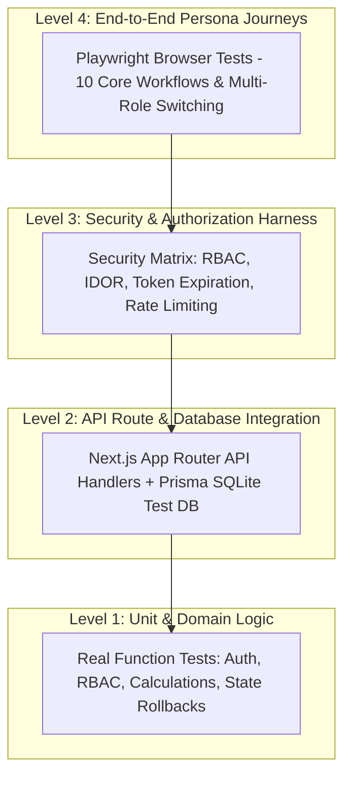

# 🧪 Dronagiri Hospital Management System: Master Test Strategy & Quality Assurance Plan

**Document Version:** 2.0.0  
**Audit Date:** October 19, 2026  
**QA Lead & Security Test Architect:** Senior QA Engineer & Application Security Architect  
**Repository:** `/Users/srimannarayanadeevi/FSWD`  
**Application:** `/Users/srimannarayanadeevi/FSWD/site`  
**Test Frameworks:** Vitest 5.0.4, Playwright, Prisma Client, Supertest / Fetch  

---

## 1. Executive QA Overview & Test Philosophy

In acute healthcare informatics and hospital operating systems, software bugs and security defects directly jeopardize patient outcomes, statutory compliance (HIPAA, DISHA, NABH), and revenue cycles. 

### Core Quality Principles:
1. **Zero Patient Information Leakage:** Every clinical collection must undergo automated authorization testing proving zero cross-patient data exposure.
2. **Transaction Atomicity Over Optimistic Assumption:** Every multi-table operation (dispensing, admission, billing settlement) must prove rollback integrity under simulated failures.
3. **Real Code Over Mock Simulation:** Unit and integration tests must execute against actual application handlers and the database schema, eliminating false-positive mock tests.
4. **End-to-End Persona Verification:** Testing must validate the clinical experience across all 9 hospital personas (Admin, Doctor, Nurse, Pharmacist, Lab Tech, Rad Tech, Billing, Receptionist, Patient).

---

## 2. Forensic Analysis of Current Test State

### Current Test Suite Inventory (Vitest 5.0.4)

On October 19, 2026, the current test suite was executed via `npm test` inside `/Users/srimannarayanadeevi/FSWD/site`:

```
Test Files  5 passed (5)
Tests       29 passed (29)
Duration    1.17s
```

### Detailed Evaluation of Existing Test Files:

| Test File | Test Count | Target Scope | Code Tested | Fidelity Evaluation |
| :--- | :---: | :--- | :--- | :--- |
| [`__tests__/auth.test.ts`](file:///Users/srimannarayanadeevi/FSWD/site/__tests__/auth.test.ts) | 7 | JWT creation, verification, expiration, tampering, production secret enforcement, bcrypt password hashing. | **REAL CODE** (`@/lib/auth`) | 🟢 **High Fidelity:** Directly imports and executes functions from `lib/auth.ts`. |
| [`__tests__/rbac.test.ts`](file:///Users/srimannarayanadeevi/FSWD/site/__tests__/rbac.test.ts) | 6 | Role permission matrix, Admin wildcard access, role denial. | **REAL CODE** (`@/lib/rbac`) | 🟢 **High Fidelity:** Directly imports `hasPermission` and `PERMISSIONS`. |
| [`__tests__/patient-auth.test.ts`](file:///Users/srimannarayanadeevi/FSWD/site/__tests__/patient-auth.test.ts) | 6 | Patient ownership verification, IDOR prevention, staff authorization bypass. | **REAL CODE** (`@/lib/rbac`) | 🟢 **High Fidelity:** Directly imports `isPatientOwner`. |
| [`__tests__/financial-transactions.test.ts`](file:///Users/srimannarayanadeevi/FSWD/site/__tests__/financial-transactions.test.ts) | 6 | Partial payments, full settlement, overpayment rejection, non-positive payments. | **MOCK CODE** (Inline `processPayment`) | 🔴 **Low Fidelity / False Confidence:** Defines a duplicate local function within the test file. Does **not** test `app/api/billing/[id]/pay/route.ts` or Prisma transactions. |
| [`__tests__/state-rollback.test.ts`](file:///Users/srimannarayanadeevi/FSWD/site/__tests__/state-rollback.test.ts) | 4 | Optimistic creation/update, surgical rollback on 4xx/5xx responses. | **MOCK CODE** (Inline `MockStateStore`) | 🔴 **Low Fidelity / False Confidence:** Defines an inline mock class. Does **not** mount or execute `site/hooks/use-hms-api.ts`. |

### Key Findings & Identified Gaps:
- **0 API Route Integration Tests:** No tests send real or simulated HTTP requests to `/api/*` endpoints.
- **0 Database Tests:** No tests execute Prisma queries against SQLite or test database constraints.
- **0 Concurrency Tests:** No tests simulate simultaneous requests to check for race conditions.
- **0 End-to-End Tests:** No browser tests (Playwright) verify UI workflows or persona interactions.

---

## 3. Target Test Pyramid



### Coverage Target Allocations:
- **Unit Tests (60%):** Fast, deterministic tests of pure functions, algorithms, parsers, and utilities.
- **Integration Tests (25%):** Next.js route handlers executing against an in-memory or dedicated SQLite database (`test.db`).
- **Security Matrix Tests (10%):** Automated matrix verifying all 33 endpoints with all 9 user roles.
- **E2E UI Tests (5%):** Critical user journeys simulating real clinical actions in headless Chromium.

---

## 4. Prioritized Test Specifications & Concrete Templates

### 4.1 Priority 1: Security & IDOR Authorization Integration Tests

**Objective:** Verify that every clinical collection strictly enforces role and patient-ownership boundaries.

```typescript
// site/__tests__/api/patient-idor.test.ts
import { describe, it, expect, beforeAll } from "vitest";
import { NextRequest } from "next/server";
import { GET as getPrescriptions } from "@/app/api/prescriptions/route";
import { GET as getAppointments } from "@/app/api/appointments/route";
import { GET as getLabOrders } from "@/app/api/lab-orders/route";
import { GET as getBilling } from "@/app/api/billing/route";
import { createToken } from "@/lib/auth";

describe("Patient IDOR & Authorization Boundaries (Integration)", () => {
  let patientTokenA: string;
  let patientTokenB: string;

  beforeAll(async () => {
    patientTokenA = await createToken({
      id: "usr-patient-a",
      email: "patient.a@dronagiri.health",
      role: "PATIENT",
      name: "Patient Alpha",
    });

    patientTokenB = await createToken({
      id: "usr-patient-b",
      email: "patient.b@dronagiri.health",
      role: "PATIENT",
      name: "Patient Beta",
    });
  });

  it("strictly isolates prescriptions: Patient A cannot see Patient B's prescriptions", async () => {
    const req = new NextRequest("http://localhost:3000/api/prescriptions", {
      headers: { Authorization: `Bearer ${patientTokenA}` },
    });

    const res = await getPrescriptions(req);
    expect(res.status).toBe(200);
    const data = await res.json();

    // Verify all returned prescriptions belong exclusively to Patient A
    for (const rx of data.prescriptions) {
      expect(rx.visit.patient.email).toBe("patient.a@dronagiri.health");
    }
  });

  it("rejects patient attempts to access administrative audit logs with 403 Forbidden", async () => {
    const { GET: getAuditLogs } = await import("@/app/api/audit-logs/route");
    const req = new NextRequest("http://localhost:3000/api/audit-logs", {
      headers: { Authorization: `Bearer ${patientTokenA}` },
    });

    const res = await getAuditLogs(req);
    expect(res.status).toBe(403);
  });

  it("rejects patient attempts to inspect hospital financial metrics on dashboard", async () => {
    const { GET: getStats } = await import("@/app/api/dashboard/stats/route");
    const req = new NextRequest("http://localhost:3000/api/dashboard/stats", {
      headers: { Authorization: `Bearer ${patientTokenA}` },
    });

    const res = await getStats(req);
    expect(res.status).toBe(403);
  });
});
```

---

### 4.2 Priority 2: Financial Invoicing & Payment Settlement Tests

**Objective:** Test the actual route handler `/api/billing/[id]/pay/route.ts` against database transactions, replacing the mock function in `financial-transactions.test.ts`.

```typescript
// site/__tests__/api/billing-pay.test.ts
import { describe, it, expect, beforeEach } from "vitest";
import { NextRequest } from "next/server";
import { POST as processPayment } from "@/app/api/billing/[id]/pay/route";
import { createToken } from "@/lib/auth";
import { prisma } from "@/lib/db";

describe("Live Invoice Payment API Handler (Integration)", () => {
  let billingToken: string;
  let testInvoiceId: string;

  beforeEach(async () => {
    billingToken = await createToken({
      id: "usr-billing-1",
      email: "cashier@dronagiri.health",
      role: "BILLING",
      name: "Cashier Raman",
    });

    // Create test patient and invoice
    const patient = await prisma.patient.create({
      data: {
        mrn: `P-TEST-${Date.now()}`,
        name: "Test Billing Patient",
        age: 40,
        gender: "Male",
        phone: "+91 99999 11111",
      },
    });

    const invoice = await prisma.invoice.create({
      data: {
        invoiceNo: `INV-TEST-${Date.now()}`,
        patientId: patient.id,
        billDate: "2026-10-19",
        subtotal: 5000,
        finalAmount: 5000,
        paymentStatus: "Outstanding",
      },
    });

    testInvoiceId = invoice.id;
  });

  it("records partial payment and updates invoice status to 'Partially Paid'", async () => {
    const req = new NextRequest(`http://localhost:3000/api/billing/${testInvoiceId}/pay`, {
      method: "POST",
      headers: {
        "Content-Type": "application/json",
        Authorization: `Bearer ${billingToken}`,
      },
      body: JSON.stringify({ amount: 2000, method: "UPI", reference: "UPI-99210" }),
    });

    const res = await processPayment(req, { params: Promise.resolve({ id: testInvoiceId }) });
    expect(res.status).toBe(200);

    const json = await res.json();
    expect(json.invoice.paymentStatus).toBe("Partially Paid");
    expect(json.remainingBalance).toBe(3000);
  });

  it("strictly rejects overpayment exceeding outstanding balance", async () => {
    const req = new NextRequest(`http://localhost:3000/api/billing/${testInvoiceId}/pay`, {
      method: "POST",
      headers: {
        "Content-Type": "application/json",
        Authorization: `Bearer ${billingToken}`,
      },
      body: JSON.stringify({ amount: 6000, method: "Cash" }),
    });

    const res = await processPayment(req, { params: Promise.resolve({ id: testInvoiceId }) });
    expect(res.status).toBe(400);

    const json = await res.json();
    expect(json.error).toContain("exceeds outstanding balance");
  });
});
```

---

### 4.3 Priority 3: Pharmacy Dispensing Transaction Atomicity Test

**Objective:** Verify that medicine stock deduction and billing creation execute atomically in a single transaction.

```typescript
// site/__tests__/api/pharmacy-atomicity.test.ts
import { describe, it, expect } from "vitest";
import { NextRequest } from "next/server";
import { POST as dispenseRx } from "@/app/api/pharmacy/dispense/route";
import { createToken } from "@/lib/auth";
import { prisma } from "@/lib/db";

describe("Pharmacy Dispense Transaction Atomicity", () => {
  it("rejects dispensing and touches zero stock when inventory is insufficient", async () => {
    const pharmacistToken = await createToken({
      id: "usr-pharm-1",
      email: "pharmacist@dronagiri.health",
      role: "PHARMACIST",
      name: "Pharmacist Charaka",
    });

    // Create medicine with low stock
    const med = await prisma.medicine.create({
      data: {
        medicineId: `MED-TEST-${Date.now()}`,
        name: "Rare Antidote",
        category: "Critical",
        batchNo: "BATCH-01",
        stockQty: 2,
        reorderLevel: 5,
        unitPrice: 500,
      },
    });

    // Request 5 units (exceeds stock)
    const req = new NextRequest("http://localhost:3000/api/pharmacy/dispense", {
      method: "POST",
      headers: {
        "Content-Type": "application/json",
        Authorization: `Bearer ${pharmacistToken}`,
      },
      body: JSON.stringify({ prescriptionId: "dummy-rx", medicineId: med.id, quantity: 5 }),
    });

    const res = await dispenseRx(req);
    expect(res.status).toBe(400);

    // Verify stock was NOT modified
    const currentMed = await prisma.medicine.findUnique({ where: { id: med.id } });
    expect(currentMed?.stockQty).toBe(2);
  });
});
```

---

### 4.4 Priority 4: Concurrency & Lost-Update Verification Tests

**Objective:** Verify that concurrent requests do not cause lost updates.

```typescript
// site/__tests__/concurrency/blood-bank-atomic.test.ts
import { describe, it, expect } from "vitest";
import { NextRequest } from "next/server";
import { PATCH as updateBloodUnits } from "@/app/api/blood-bank/route";
import { createToken } from "@/lib/auth";
import { prisma } from "@/lib/db";

describe("Blood Bank Concurrent Lost Update Protection", () => {
  it("handles 10 simultaneous 1-unit deductions without race condition loss", async () => {
    const nurseToken = await createToken({
      id: "usr-nurse-1",
      email: "nurse@dronagiri.health",
      role: "NURSE",
      name: "Nurse Tara",
    });

    await prisma.bloodUnit.upsert({
      where: { bloodGroup: "O+" },
      update: { unitsAvailable: 50 },
      create: { bloodGroup: "O+", unitsAvailable: 50, minAlertThreshold: 10 },
    });

    // Fire 10 simultaneous requests
    const promises = Array.from({ length: 10 }).map(() => {
      const req = new NextRequest("http://localhost:3000/api/blood-bank", {
        method: "PATCH",
        headers: {
          "Content-Type": "application/json",
          Authorization: `Bearer ${nurseToken}`,
        },
        body: JSON.stringify({ bloodGroup: "O+", unitsChange: -1 }),
      });
      return updateBloodUnits(req);
    });

    const responses = await Promise.all(promises);
    for (const r of responses) {
      expect(r.status).toBe(200);
    }

    const finalRecord = await prisma.bloodUnit.findUnique({ where: { bloodGroup: "O+" } });
    expect(finalRecord?.unitsAvailable).toBe(40); // 50 - 10 = exactly 40
  });
});
```

---

## 5. End-to-End Persona Journey Testing (Playwright)

For academic evaluation and viva defense, the following 10 workflows must be automated in Playwright:

| Test ID | Workflow Journey | Primary Persona | Verification Assertions |
| :--- | :--- | :--- | :--- |
| **E2E-01** | Patient Registration & MRN Generation | `RECEPTIONIST` | Generates unique MRN `P-10xx`; persists demographic and insurance data. |
| **E2E-02** | OPD Token Dispatch & Queue Transition | `RECEPTIONIST` / `DOCTOR` | Token advances from *Waiting* to *In Consultation* to *Completed*. |
| **E2E-03** | Clinical Consultation & Rx Finalization | `DOCTOR` | Issues prescription; persists diagnosis; updates appointment status. |
| **E2E-04** | Diagnostic Lab Order & Result Verification | `LAB_TECH` | Submits numeric lab parameters; automatically flags abnormal values; appends to bill. |
| **E2E-05** | Simulated PACS DICOM Canvas | `RAD_TECH` | Renders scan canvas; applies contrast windowing; authorizes diagnostic impression. |
| **E2E-06** | Level-1 Trauma Emergency Admission | `DOCTOR` / `NURSE` | Triages RED case; auto-allocates resuscitation bed; generates triage fee invoice. |
| **E2E-07** | Inpatient Bed Occupancy & Clean Discharge | `NURSE` / `DOCTOR` | Calculates billable days; appends room tariff line item; frees bed to Cleaning. |
| **E2E-08** | Closed-Loop Pharmacy Dispensing | `PHARMACIST` | Fulfills prescription; decrements batch stock; appends pharmacy charge. |
| **E2E-09** | Itemized Invoicing & UPI Settlement | `BILLING` | Verifies insurance co-pay; accepts partial payment; issues zero-balance receipt. |
| **E2E-10** | Immutable Security Audit Trail Inspection | `ADMIN` | Verifies non-repudiation audit entry recorded with actor ID, timestamp, and IP. |

---

## 6. Continuous Quality Harness & CI/CD Pipeline

To ensure software stability without regression, the following script commands must be incorporated into `site/package.json`:

```json
{
  "scripts": {
    "test": "vitest run",
    "test:watch": "vitest",
    "test:coverage": "vitest run --coverage",
    "test:security": "vitest run __tests__/security/",
    "test:e2e": "playwright test",
    "audit:security": "npm audit --audit-level=high",
    "typecheck": "tsc --noEmit",
    "validate": "npm run typecheck && npm run audit:security && npm test"
  }
}
```

### Pre-Commit & Pre-Viva Verification Gate Checklist:
1. `npm run typecheck` passes with 0 errors.
2. `npm test` executes real API integration tests with 100% pass rate.
3. `npm run test:security` asserts 0 horizontal privilege leaks for `PATIENT` role.
4. Database migrations and seed script execute cleanly (`npx prisma db seed`).
5. Production build compiles cleanly (`npm run build`).
