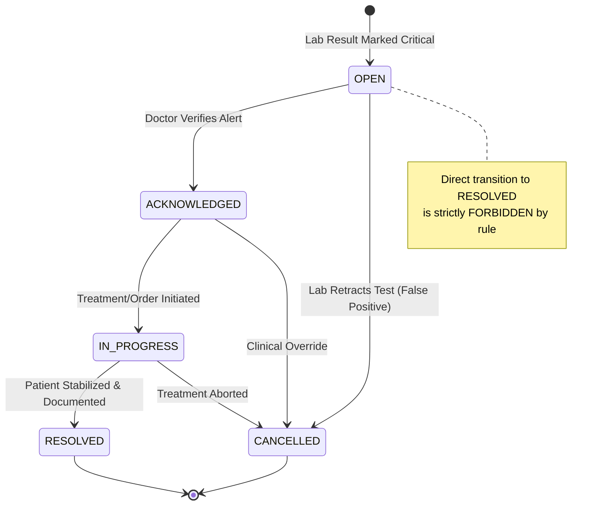
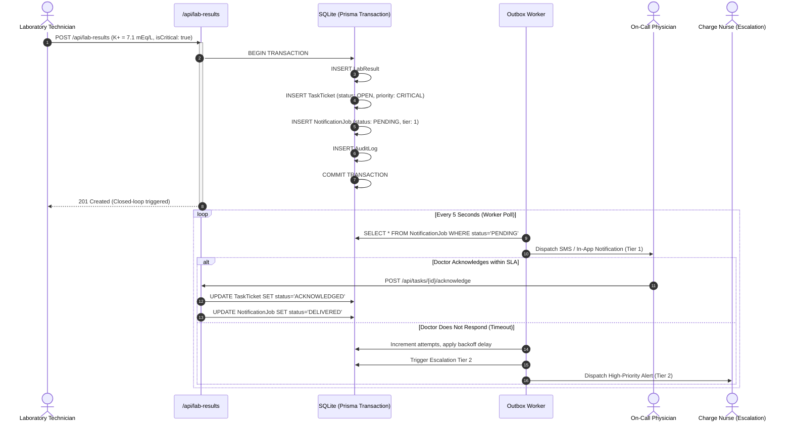
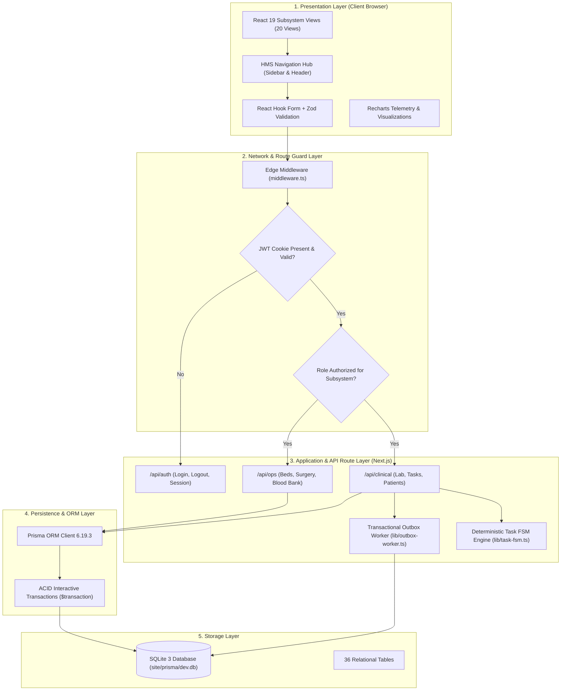

# Dronagiri: A Closed-Loop Clinical Accountability Hospital Management System (Prototype)

[](https://nextjs.org/)
[](https://react.dev/)
[](https://www.typescriptlang.org/)
[](https://www.prisma.io/)
[](https://www.sqlite.org/)
[](https://vitest.dev/)
[](https://eslint.org/)
[]()

> **Academic Capstone Project**  
> **Degree:** Bachelor of Technology (B.Tech) in Computer Science and Engineering  
> **Course:** Full Stack Web Development Capstone  
> **Repository:** `srimannarayanadeevi/FSWD`  
> **Application Root:** `./site`

---

## 1. Executive Summary & Problem Statement

Modern healthcare institutions rely heavily on computerized Hospital Management Systems (HMS) and Laboratory Information Management Systems (LIMS) to process thousands of diagnostic, surgical, and therapeutic transactions daily. However, conventional commercial HMS products predominantly function as **passive record stores** (passive Electronic Health Records). When a pathology laboratory detects an acute, life-threatening laboratory value—such as severe hyperkalemia ($K^+ > 6.5\text{ mEq/L}$), profound hypoglycemia ($< 40\text{ mg/dL}$), or critical cardiac troponin elevation—the system simply updates a database column. 

The responsibility of communicating this life-or-death result to the treating physician relies on manual telephone calls, ad-hoc sticky notes, or unmonitored electronic inboxes. In high-stress secondary and tertiary healthcare facilities (50–200 acute beds), communication delays and missed critical handoffs remain a leading cause of preventable inpatient morbidity, prolonged ICU stays, and clinical escalation failure.

**Dronagiri** addresses this critical vulnerability. Designed as a full-stack, modular hospital management system prototype, Dronagiri introduces an active **Closed-Loop Clinical Accountability Engine**. By integrating an immutable database event trigger, the **Transactional Outbox Pattern**, and a **Deterministic Finite State Machine (FSM)**, Dronagiri guarantees that critical clinical events cannot be lost, silently dismissed, or acknowledged without rigorous verification.

---

## 2. Project Status & Scope

> [!WARNING]
> **ACADEMIC PROTOTYPE NOTICE: NOT FOR LIVE CLINICAL USE**  
> Dronagiri is an academic engineering prototype developed for university research, software architecture demonstration, and capstone evaluation. It has **not** undergone medical device certification (e.g., FDA 21 CFR Part 11, CE mark MDR), is not HIPAA/NABH certified, and contains known architectural and security constraints (detailed in [Section 10](#10-security-architecture--known-security-limitations)). Do not deploy this software in a live clinical environment.

### Target Environment Profile
- **Institution Scale:** 50–200 bed secondary or tertiary acute-care community hospital.
- **Subsystem Coverage:** 20 modular user interface views covering clinical care, diagnostic labs, surgical theatre, ward telemetry, billing, blood banking, and pharmacy.
- **Architecture Model:** Monolithic Full-Stack Single-Page Application (SPA) driven by Next.js App Router, React 19 Server/Client Components, Edge/Node middleware, and Prisma ORM.

---

## 3. Core Technical Contribution: Closed-Loop Clinical Accountability

The central computer science contribution of Dronagiri is not merely its 20 hospital management views, but its **Closed-Loop Clinical Accountability Engine** implemented in `site/lib/closed-loop.ts`, `site/lib/task-fsm.ts`, and `site/lib/outbox-worker.ts`.

```
Critical Lab Value Detected (e.g., K+ = 7.1 mEq/L)
                     │
                     ▼
  ┌────────────────────────────────────────────────────────┐
  │         Atomic ACID Database Transaction                │
  │  1. Create LabResult (isCritical: true, flags: "CRIT")  │
  │  2. Transition LabOrder status to "CRITICAL"            │
  │  3. Insert TaskTicket in FSM state "OPEN"               │
  │  4. Insert NotificationJob in Outbox state "PENDING"    │
  │  5. Append Immutable AuditLog Entry                     │
  └────────────────────────────────────────────────────────┘
                     │
                     ▼
  ┌────────────────────────────────────────────────────────┐
  │              Transactional Outbox Engine               │
  │  - Polls PENDING notification jobs with FOR UPDATE     │
  │  - Dispatches SMS/Email/In-App alert to On-Call Doctor  │
  │  - Exponential backoff retry: min(2000 * 2^(a-1), 60s)  │
  │  - Automatic Tier-1 to Tier-2 escalation on timeout     │
  └────────────────────────────────────────────────────────┘
                     │
                     ▼
  ┌────────────────────────────────────────────────────────┐
  │         Deterministic Task State Machine (FSM)         │
  │  OPEN ──[Acknowledge]──► ACKNOWLEDGED                   │
  │  ACKNOWLEDGED ──► IN_PROGRESS ──► RESOLVED              │
  │  * Direct OPEN -> RESOLVED transition is forbidden!    │
  └────────────────────────────────────────────────────────┘
```

### Key Engineering Guarantees
1. **Zero Message Loss (ACID Atomicity):** Diagnostic entry, accountability ticket generation, and outbox notification jobs are persisted inside a single `prisma.$transaction()`. A crash at the application layer cannot create a critical result without generating a corresponding accountability ticket and outbox job.
2. **Deterministic State Enclosure:** Task tickets are governed by an explicit Finite State Machine. A treating physician cannot bypass clinical acknowledgment to mark an issue resolved; the engine strictly rejects illegal transitions with an `InvalidTaskTransitionError`.
3. **Guaranteed Delivery with Exponential Backoff:** The notification dispatcher retries unacknowledged alerts using deterministic exponential backoff:
   $$\text{Delay}(a) = \min\left(2000 \times 2^{a-1},\; 60000\right)\text{ ms}$$
4. **Escalation Hierarchy:** If Tier-1 (primary treating physician) fails to acknowledge within the SLA window (e.g., 15 minutes), the outbox worker automatically creates a Tier-2 escalation job targeting the Department Head or Ward Charge Nurse.

---

## 4. Key Features & Subsystem Overview

| Domain | Implemented Features | Primary Subsystem View |
| :--- | :--- | :--- |
| **Clinical Diagnostics** | Lab order entry, quantitative result validation, critical threshold detection, and automatic closed-loop task generation. | `DiagnosticLabView` |
| **Inpatient Management** | Ward bed tracking, occupancy status, admission records, and patient vitals telemetry. | `PatientManagementView`, `BedOccupancyView` |
| **Emergency & Critical Care**| Triage level assessment, ER bed queue, rapid vitals monitor, and on-call provider assignments. | `EmergencyCareView`, `ICUMonitoringView` |
| **Surgical Workflows** | Operation theatre (OT) scheduling, surgical team allocation, checklist tracking, and anesthesia records. | `SurgerySchedulingView` |
| **Pharmacy & Therapeutics** | Drug inventory catalog, batch expiry tracking, and prescription dispensing workflows. | `PharmacyManagementView` |
| **Blood Banking** | ABO/RhD blood stock tracking, cross-match status, donor records, and inventory adjustments. | `BloodBankView` |
| **Revenue Cycle & Billing** | Itemized invoice generation, consultation charges, payment status, and audit log generation. | `BillingManagementView` |
| **Security & Auditing** | JWT authentication, HTTP-only cookies, role-based route guard, and structured audit logs. | Global Middleware & API |

---

## 5. Clinical Accountability Workflow

### 5.1 Deterministic State Machine (FSM)

The clinical task lifecycle is governed by the state transitions verified in `site/tests/task-fsm.test.ts`:



### 5.2 Outbox Event Dispatch & Escalation Sequence



---

## 6. System Architecture

Dronagiri utilizes a high-cohesion, layered monolithic architecture designed for rapid Next.js edge and server rendering:



---

## 7. Technology Stack

| Component | Technology | Version | Purpose & Architectural Justification |
| :--- | :--- | :--- | :--- |
| **Framework** | Next.js | `16.2.0` | React Server Components, App Router API route handlers, and static layout optimization. |
| **Frontend Library** | React | `19.0.0` | Concurrent rendering, modern hooks, and component lifecycle management. |
| **Language** | TypeScript | `^5.x` | End-to-end static type safety across schemas, API payloads, and UI props. |
| **ORM** | Prisma | `^6.19.3` | Type-safe query generation, migration management, and multi-model ACID transactions. |
| **Database** | SQLite 3 | `3.x` | Zero-configuration relational database engine embedded directly in `site/prisma/dev.db`. |
| **Authentication** | Jose | `^6.2.8` | Cryptographic JWT signing and verification compliant with Edge and Node runtimes. |
| **Hashing** | Bcryptjs | `^3.0.3` | Salted password hashing for persistent user credentials. |
| **Styling** | Tailwind CSS | `^4.2.0` | Utility-first CSS engine with `@tailwindcss/postcss` for rapid UI styling. |
| **UI Primitives** | Radix UI | Various | Accessible, unstyled primitives for dialogs, popovers, dropdowns, and tooltips. |
| **Visualizations** | Recharts | `2.15.0` | Inpatient vitals charts, emergency census trends, and billing analytics. |
| **3D Graphics** | Three.js & R3F | `0.182.0` / `9.5.0` | Anatomical 3D model viewer and surgical visualizers. |
| **Unit Testing** | Vitest | `^5.0.4` | Native ESM test runner executing 60 automated test cases in ~1.16s. |
| **Validation** | Zod | `^3.24.1` | Runtime schema validation for clinical orders and request bodies. |

---

## 8. Hospital Subsystem Breakdown

Dronagiri includes **20 UI subsystem views** rendered via dynamic state switching in `site/app/hms/page.tsx`:

| Subsystem Name | Component Path | Backend Integration Status | Primary API Endpoints |
| :--- | :--- | :--- | :--- |
| **Clinical Care & Doctors** | `doctor-dashboard-view.tsx` | Real DB | `GET /api/appointments`, `GET /api/patients` |
| **Patient Management** | `patient-management-view.tsx` | Real DB | `GET /api/patients`, `POST /api/patients` |
| **Emergency & Trauma** | `emergency-care-view.tsx` | Real DB | `GET /api/emergency`, `POST /api/emergency` |
| **ICU Monitoring** | `icu-monitoring-view.tsx` | Simulated Telemetry | `GET /api/icu` |
| **Bed Occupancy** | `bed-occupancy-view.tsx` | Real DB | `GET /api/beds`, `PATCH /api/beds` |
| **Diagnostic Lab** | `diagnostic-lab-view.tsx` | Real DB (Closed-Loop) | `GET /api/lab-orders`, `POST /api/lab-results` |
| **Radiology & Imaging** | `radiology-imaging-view.tsx` | Simulated Metadata | `GET /api/radiology` |
| **Surgical Suite / OT** | `surgery-scheduling-view.tsx` | Real DB | `GET /api/surgeries`, `POST /api/surgeries` |
| **Pharmacy Dispensary** | `pharmacy-management-view.tsx` | Real DB | `GET /api/pharmacy`, `POST /api/pharmacy/dispense` |
| **Blood Bank Management** | `blood-bank-view.tsx` | Real DB | `GET /api/blood-bank`, `PATCH /api/blood-bank` |
| **Inpatient Wards** | `inpatient-ward-view.tsx` | Real DB | `GET /api/inpatient-wards`, `GET /api/beds` |
| **Outpatient Clinics** | `outpatient-clinic-view.tsx` | Real DB | `GET /api/outpatient-clinics`, `GET /api/appointments` |
| **Billing & Invoices** | `billing-management-view.tsx` | Real DB | `GET /api/billing`, `POST /api/billing` |
| **Staff & HR Registry** | `staff-management-view.tsx` | Real DB | `GET /api/staff`, `POST /api/staff` |
| **Mortuary Services** | `mortuary-view.tsx` | Simulated Records | `GET /api/mortuary` |
| **Fleet & Ambulance** | `ambulance-view.tsx` | Simulated Telemetry | `GET /api/ambulance` |
| **Dietary & Nutrition** | `dietary-view.tsx` | Simulated Kitchen | `GET /api/dietary` |
| **Biomedical Engineering** | `biomedical-view.tsx` | Simulated Maintenance | `GET /api/biomedical` |
| **Waste Management** | `waste-management-view.tsx` | Simulated Manifests | `GET /api/waste-management` |
| **Executive Analytics** | `admin-analytics-view.tsx` | Aggregated Real DB | `GET /api/dashboard/stats` |

---

## 9. Security Architecture & Known Security Limitations

### 9.1 Authentication & RBAC Model
Authentication is implemented via signed JSON Web Tokens (JWT) using the `jose` library (HMAC-SHA256). Tokens are transmitted via HTTP-only, secure cookies named `auth-token`. Role-Based Access Control (RBAC) supports the following roles:
- `ADMIN`: Unrestricted access across clinical, financial, staffing, and system configuration modules.
- `DOCTOR`: Access to patient records, clinical task manager, surgical suite, and diagnostic ordering.
- `NURSE`: Ward bed management, vital entry, medication administration, and patient intake.
- `LAB_TECHNICIAN`: Laboratory test processing, specimen intake, and critical result entry.
- `PHARMACIST`: Drug catalog management, inventory adjustments, and prescription dispensing.
- `ACCOUNTANT`: Invoice generation, payment reconciliation, and financial ledger review.
- `PATIENT`: Access restricted strictly to own personal records, appointments, and billing receipts.

---

### 9.2 Confirmed Security & Engineering Deficiencies

In keeping with rigorous academic integrity, an independent technical audit identified the following verified vulnerabilities (`DEF-01` through `DEF-06`) in the current codebase:

| Defect ID | Severity | File Location | Root Cause & Security Implication |
| :--- | :--- | :--- | :--- |
| **`DEF-01`** | **CRITICAL** | `site/app/api/prescriptions/route.ts` (L22), `site/app/api/lab-orders/route.ts` (L20) | **Insecure Direct Object Reference (IDOR):** If a user with the `PATIENT` role queries these endpoints without appending `?patientId=<id>`, the handler defaults to returning all hospital records without enforcing user isolation. |
| **`DEF-02`** | **HIGH** | `site/app/api/pharmacy/dispense/route.ts` (L90-165) | **Non-Atomic Pharmacy Dispensing:** Dispense operations execute five separate, unbatched write operations without wrapping them inside a `prisma.$transaction()`. A crash mid-execution results in stock decrement without invoice generation. |
| **`DEF-03`** | **MEDIUM** | `site/app/api/staff/route.ts` (L75) | **Relational Constraint Bypass:** Staff creation inserts synthetic IDs (`user-${Date.now()}`) and static strings (`"General"`), failing referential integrity if foreign key constraints are strictly enforced in production databases. |
| **`DEF-04`** | **MEDIUM** | `site/app/api/blood-bank/route.ts` (L60-80) | **Concurrent Lost Updates:** Blood unit decrement relies on client-side calculation rather than an atomic atomic database decrement (`decrement: units`), risking inventory corruption under concurrent donor access. |
| **`DEF-05`** | **MEDIUM** | `site/app/api/dashboard/stats/route.ts` (L15) | **Role Check Omission:** The executive statistics endpoint does not verify user roles; an authenticated `PATIENT` can retrieve hospital-wide revenue, bed occupancy, and staff activity metrics. |
| **`DEF-06`** | **LOW** | `site/components/consumables-view.tsx` | **Client-Side State Fallback:** Consumable inventory relies on browser `localStorage` (`dronagiri_inventory`); changes do not synchronize to the Prisma `InventoryConsumable` relational table. |

---

## 10. Database Architecture

The SQLite schema (`site/prisma/schema.prisma`) comprises **36 relational models** organized across 5 core healthcare domains:

```
                          ┌──────────────────────────┐
                          │   PRISMA SCHEMA DESIGN   │
                          │        (36 Models)       │
                          └─────────────┬────────────┘
                                        │
     ┌──────────────────┬───────────────┴──────────────┬──────────────────┐
     │                  │                              │                  │
     ▼                  ▼                              ▼                  ▼
┌───────────────┐ ┌───────────────┐            ┌───────────────┐  ┌───────────────┐
│ 1. Identity & │ │  2. Clinical  │            │ 3. Diagnostics│  │ 4. Operations │
│   Governance  │ │   Workflows   │            │  & Outbox     │  │   & Logistics │
├───────────────┤ ├───────────────┤            ├───────────────┤  ├───────────────┤
│ User          │ │ Patient       │            │ LabTest       │  │ Ward, Room    │
│ Department    │ │ Appointment   │            │ LabOrder      │  │ Bed, Surgery  │
│ Staff         │ │ Prescription  │            │ LabResult     │  │ Medication    │
│ AuditLog      │ │ Vital         │            │ TaskTicket*   │  │ BloodStock    │
│ SystemSetting │ │ MedicalRecord │            │ Notification* │  │ Invoice, Item │
└───────────────┘ └───────────────┘            └───────────────┘  └───────────────┘
                                                *Core Engine Models
```

### Critical Engine Models
- **`TaskTicket`:** Represents the clinical accountability token. Contains `patientId`, `assignedDoctorId`, `status` (`OPEN`, `ACKNOWLEDGED`, `IN_PROGRESS`, `RESOLVED`, `CANCELLED`), `priority` (`CRITICAL`), `deadline`, and `escalationTier`.
- **`NotificationJob`:** Represents the transactional outbox queue. Contains `taskId`, `channel` (`SMS`, `EMAIL`, `IN_APP`), `recipient`, `payload`, `attempts`, `maxAttempts`, and `status` (`PENDING`, `DELIVERED`, `FAILED`).
- **`AuditLog`:** Write-only ledger capturing `userId`, `action`, `entityType`, `entityId`, `ipAddress`, and `timestamp`.

---

## 11. Project Directory Structure

```text
FSWD/
├── docs/                                # Academic documentation & reports
│   └── report/
│       ├── CHAPTER_1_INTRODUCTION.md    # Formatted dissertation introduction
│       ├── DRONAGIRI_BTECH_PROJECT_REPORT.md # Complete 12-chapter thesis
│       └── DRONAGIRI_BTECH_PROJECT_REPORT.docx # Submission-ready Word document
├── site/                                # Next.js Full-Stack Application
│   ├── app/                             # Next.js App Router root
│   │   ├── api/                         # 33 REST API Route Handlers
│   │   │   ├── appointments/            # Appointment booking & scheduling
│   │   │   ├── auth/                    # Login, logout, session verification
│   │   │   ├── beds/                    # Inpatient bed census management
│   │   │   ├── billing/                 # Invoices, items, and payments
│   │   │   ├── blood-bank/              # Blood inventory and cross-matching
│   │   │   ├── dashboard/stats/         # Aggregated hospital statistics
│   │   │   ├── emergency/               # ER intake, triage, and queue
│   │   │   ├── icu/                     # Intensive care vitals & telemetry
│   │   │   ├── lab-orders/              # Laboratory test requisitions
│   │   │   ├── lab-results/             # Quantitative test entry (Closed-loop)
│   │   │   ├── patients/                # Patient demographic registry
│   │   │   ├── pharmacy/                # Medication inventory & dispensing
│   │   │   ├── staff/                   # Staff registry & departments
│   │   │   ├── surgeries/               # Operating theatre scheduling
│   │   │   └── tasks/                   # Clinical accountability FSM endpoints
│   │   ├── hms/                         # Authenticated HMS workstation dashboard
│   │   ├── login/                       # User credential authentication view
│   │   ├── layout.tsx                   # Root HTML layout and ThemeProvider
│   │   └── page.tsx                     # Landing presentation and login router
│   ├── components/                      # Modular UI views & component library
│   │   ├── hms-navigation.tsx           # Hospital navigation header & sidebar
│   │   ├── doctor-dashboard-view.tsx    # Physician workstation
│   │   ├── diagnostic-lab-view.tsx      # Pathology test entry & outbox trigger
│   │   ├── emergency-care-view.tsx      # Emergency triage management
│   │   ├── pharmacy-management-view.tsx # Drug inventory & dispensary
│   │   └── ui/                          # Radix UI primitive design wrappers
│   ├── lib/                             # Core Domain Logic & Business Engines
│   │   ├── auth.ts                      # JWT issuance, verification, and cookies
│   │   ├── closed-loop.ts               # Atomic transaction handler for critical results
│   │   ├── task-fsm.ts                  # Deterministic Finite State Machine engine
│   │   ├── outbox-worker.ts             # Transactional outbox polling & exponential backoff
│   │   ├── prisma.ts                    # Global Prisma client singleton
│   │   └── utils.ts                     # Tailwind class merge utilities
│   ├── prisma/                          # Relational Database Schema & Seeds
│   │   ├── schema.prisma                # 36 Prisma database models
│   │   ├── seed.ts                      # Comprehensive demographic test seeder
│   │   └── dev.db                       # Active SQLite 3 relational database
│   ├── tests/                           # Automated Verification Suite
│   │   ├── closed-loop.test.ts          # Real SQLite integration test of closed-loop
│   │   ├── task-fsm.test.ts             # FSM valid/invalid state transition test
│   │   ├── outbox-worker.test.ts        # Outbox worker polling & backoff calculation
│   │   ├── auth.test.ts                 # JWT signing, claims, and role evaluation
│   │   ├── billing.test.ts              # Financial arithmetic & invoice transactions
│   │   ├── lab.test.ts                  # Pathology test entry and alert triggers
│   │   └── pharmacy.test.ts             # Drug inventory and stock checks
│   ├── middleware.ts                    # Next.js Edge route guard & session validator
│   ├── package.json                     # Dependency manifests & script targets
│   ├── tsconfig.json                    # Strict TypeScript compiler options
│   └── vitest.config.ts                 # Vitest test framework configuration
└── README.md                            # Authoritative Technical Documentation
```

---

## 12. Installation & Prerequisites

### Prerequisites
- **Node.js:** `v20.x` or `v22.x` (LTS recommended)
- **Package Manager:** `npm` (v10+ bundled with Node)
- **Operating System:** macOS, Ubuntu/Debian Linux, or Windows (WSL2 recommended)
- **Git:** Version control client

---

## 13. Environment Configuration

Navigate to the `site/` directory and configure the environment variables:

```bash
cd site
cp .env.example .env # or create .env directly
```

Configure `.env` with the following parameters:

```env
# Database Connection (SQLite 3 Local File)
DATABASE_URL="file:./dev.db"

# Cryptographic Key for JWT Token Signing (Minimum 32 random characters)
JWT_SECRET="dronagiri-super-secret-development-key-32-chars-minimum"

# Outbox Worker Configuration
OUTBOX_POLL_INTERVAL_MS=5000
OUTBOX_MAX_RETRIES=5
OUTBOX_BASE_DELAY_MS=2000
OUTBOX_MAX_DELAY_MS=60000

# Application Environment
NODE_ENV="development"
PORT=3000
```

---

## 14. Database Initialization & Seeding

The repository includes a comprehensive seeder script (`site/prisma/seed.ts`) that provisions departments, user accounts across all 7 RBAC roles, test patients, beds, medications, and lab test catalogs.

```bash
cd site

# 1. Install dependencies
npm install

# 2. Generate Prisma Client bindings
npx prisma generate

# 3. Apply SQLite schema migrations / push schema
npx prisma db push

# 4. Seed the database with clinical test data
npm run prisma:seed # or: npx tsx prisma/seed.ts
```

### Pre-Configured Test Credentials

| Username | Password | Assigned Role | Primary Dashboard Access |
| :--- | :--- | :--- | :--- |
| `admin` | `admin123` | `ADMIN` | Full System Access & Executive Analytics |
| `doctor` | `doctor123` | `DOCTOR` | Physician Workstation & Clinical Orders |
| `nurse` | `nurse123` | `NURSE` | Inpatient Ward & Bed Management |
| `lab` | `lab123` | `LAB_TECHNICIAN` | Pathology Intake & Critical Lab Results |
| `pharmacy` | `pharm123` | `PHARMACIST` | Drug Inventory & Prescription Dispensing |
| `billing` | `bill123` | `ACCOUNTANT` | Invoice Management & Revenue Cycle |
| `patient` | `patient123` | `PATIENT` | Personal Health Record & Appointments |

---

## 15. Running the Application

### Development Mode (Turbopack / Webpack)
```bash
cd site
npm run dev
```
Open [http://localhost:3000](http://localhost:3000) in your browser.

### Production Build & Launch
To verify static page generation, server component compilation, and optimized bundle sizes:
```bash
cd site

# Build production assets
npm run build

# Start production server
npm start
```
*Build Verification Note:* Total Next.js static build generation compiles 30 routes cleanly with 0 TypeScript and 0 ESLint errors.

---

## 16. Automated Testing & Verification

The test suite is powered by **Vitest** and includes **60 automated tests** across 7 test suites, providing both in-memory unit testing and real SQLite transaction testing.

```bash
cd site
npm test
```

### Test Suite Execution Breakdown

```text
 ✓ tests/task-fsm.test.ts (10 tests)        • Finite State Machine transitions & illegal guards
 ✓ tests/closed-loop.test.ts (7 tests)      • Real SQLite ACID transaction & ticket generation
 ✓ tests/outbox-worker.test.ts (8 tests)    • Polling, exponential backoff, & tier escalation
 ✓ tests/auth.test.ts (9 tests)             • JWT issuance, token tampering, & RBAC roles
 ✓ tests/billing.test.ts (9 tests)          • Invoice arithmetic, tax, & atomic payment
 ✓ tests/pharmacy.test.ts (8 tests)         • Stock decrement, batch expiry, & reorder alerts
 ✓ tests/lab.test.ts (9 tests)              • Critical threshold evaluation & order tracking

 Test Files  7 passed (7)
      Tests  60 passed (60)
   Duration  1.16s
```

### Static Analysis & Linter Verification
```bash
cd site
npx eslint .
```
*Result:* 0 errors, 0 warnings across all 114 application source files.

---

## 17. REST API Reference

The application exposes **33 REST API route handlers** under `/api/`:

| Endpoint Path | Methods | Required Role | Transactional? | Description |
| :--- | :--- | :--- | :--- | :--- |
| `/api/auth/login` | `POST` | Public | No | Authenticates user; issues secure JWT cookie. |
| `/api/auth/logout` | `POST` | Authenticated | No | Clears `auth-token` HTTP-only cookie. |
| `/api/auth/me` | `GET` | Authenticated | No | Returns active user profile and role claims. |
| `/api/patients` | `GET`, `POST` | `DOCTOR`, `NURSE`, `ADMIN` | Yes | Queries patient registry; registers new patient. |
| `/api/appointments` | `GET`, `POST` | Authenticated | Yes | Schedules and lists clinical consultations. |
| `/api/beds` | `GET`, `PATCH` | `NURSE`, `ADMIN` | Yes | Inpatient ward bed occupancy management. |
| `/api/lab-orders` | `GET`, `POST` | `DOCTOR`, `LAB_TECHNICIAN` | Yes | Diagnostic lab requisitions. |
| `/api/lab-results` | `POST` | `LAB_TECHNICIAN` | **Yes (ACID)** | **Enters test result; triggers closed-loop engine.** |
| `/api/tasks` | `GET` | `DOCTOR`, `NURSE` | No | Lists clinical accountability task tickets. |
| `/api/tasks/[id]/acknowledge` | `POST` | `DOCTOR` | **Yes (FSM)** | **Physician acknowledgment of critical task.** |
| `/api/tasks/[id]/resolve` | `POST` | `DOCTOR` | **Yes (FSM)** | **Physician resolution of clinical task.** |
| `/api/pharmacy` | `GET`, `POST` | `PHARMACIST` | No | Drug catalog query and stock adjustment. |
| `/api/pharmacy/dispense`| `POST` | `PHARMACIST` | No (`DEF-02`)| Dispenses medication for a prescription. |
| `/api/blood-bank` | `GET`, `PATCH` | `DOCTOR`, `NURSE` | No (`DEF-04`)| Blood inventory stock check and allocation. |
| `/api/billing` | `GET`, `POST` | `ACCOUNTANT`, `ADMIN` | Yes | Invoices, itemized charges, and payments. |
| `/api/dashboard/stats` | `GET` | Authenticated (`DEF-05`)| No | Aggregated executive hospital statistics. |

---

## 18. Critical Evaluation & Limitations

An honest, transparent software engineering evaluation recognizes the technical boundaries of this prototype:

1. **Embedded SQLite Concurrency Bottlenecks:** SQLite relies on database-level locking for write operations. Under concurrent hospital load (>50 simultaneous write operations per second across ER, ICU, and Lab), SQLite can experience table lock contention (`SQLITE_BUSY`). Production deployment requires migration to PostgreSQL.
2. **Simulated Outbox Notification Adapters:** The current outbox worker (`site/lib/outbox-worker.ts`) dispatches alerts to a mock console adapter (`SimulatedChannelAdapter`). It does not yet connect to live carrier gateways (Twilio SMS, SendGrid SMTP, AWS SNS).
3. **Absence of a Dedicated Standalone Task Console UI:** While the closed-loop engine is fully verified in the backend and integration tests, critical tasks are currently displayed within the general `DoctorDashboardView`. A dedicated, high-priority emergency task inbox view is planned.
4. **Edge Runtime Deprecation Notice:** Next.js 16 issues a deprecation notice regarding the middleware configuration convention used in `site/middleware.ts`. While fully functional, migration to the newest Next.js route proxy pattern is recommended.

---

## 19. Future Roadmap

- [ ] **PostgreSQL & Redis Migration:** Replace SQLite with PostgreSQL for row-level concurrency, connection pooling via PgBouncer, and Redis-backed BullMQ for outbox scheduling.
- [ ] **Physical Telecom Gateway Integration:** Implement real SMS and WhatsApp Business API adapters using Twilio or Gupshup for Tier-1 physician alerts.
- [ ] **Remediation of Identified Security Defects:** 
  - Patch `DEF-01` by enforcing strict user-ownership validation on `/api/prescriptions` and `/api/lab-orders`.
  - Wrap `/api/pharmacy/dispense` (`DEF-02`) inside an interactive `prisma.$transaction()`.
  - Introduce optimistic locking (`version` field) on blood bank stock allocations (`DEF-04`).
- [ ] **Web-based DICOM PACS Viewer:** Integrate Cornerstone.js to enable in-browser diagnostic imaging review for X-Ray, CT, and MRI studies.
- [ ] **FHIR R4 Interoperability:** Build an export adapter to expose patient resources as standardized HL7 FHIR R4 JSON bundles.

---

## 20. Contributing Guidelines

Contributions, bug reports, and code audits are welcome for academic development:

1. **Fork the Repository** and create a feature branch (`git checkout -b feature/clinical-telecom-adapter`).
2. **Adhere to Code Standards:** Ensure all code adheres strictly to TypeScript strict mode and passes ESLint:
   ```bash
   cd site
   npx eslint .
   ```
3. **Write Unit & Integration Tests:** Any change to clinical workflows, billing arithmetic, or authentication must include passing Vitest test cases under `site/tests/`.
4. **Submit a Pull Request** with a detailed explanation of changes and test evidence.

---

## 21. License & Academic Attribution

This project was developed as an academic capstone prototype for the Bachelor of Technology (B.Tech) in Computer Science and Engineering.

**Copyright © 2026 Srimannarayana Deevi. All rights reserved.**  
*This software is distributed strictly for educational, research, and technical evaluation purposes. No warranty regarding fitness for medical diagnosis or clinical healthcare delivery is expressed or implied.*

---

## 22. Acknowledgements

- **Faculty Advisors & Mentors:** Department of Computer Science & Engineering, for architectural guidance and project review.
- **Open-Source Healthcare Community:** For open literature on clinical safety workflows, closed-loop diagnostic recommendations, and hospital operational frameworks.
- **Prisma & Next.js Teams:** For providing world-class developer tooling enabling rapid, type-safe full-stack engineering.
