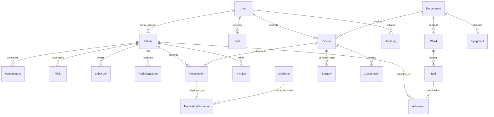

# 🏗️ Technical Architecture Document
## Dronagiri (Gandhamadana) — Enterprise Hospital Operating System

**Document Version:** 1.0.0  
**Technology Stack:** Next.js 16.2 (App Router), React 19, TypeScript 5.x, Prisma ORM 6.19, SQLite / PostgreSQL, Tailwind CSS v4  

---

## 1. High-Level Architectural Overview

Dronagiri is built on a **Modular Monolith** architecture utilizing Next.js 16 App Router, React 19, and Prisma ORM. The system separates concerns across five distinct architectural layers:

```
┌─────────────────────────────────────────────────────────────────────────────┐
│                             CLIENT LAYER (UI)                               │
│  React 19 Server/Client Components • Radix UI • Lucide Icons • Recharts     │
│  Simulated Canvas PACS • Three.js 3D Showcase • Sonner Toasts               │
└──────────────────────────────────────┬──────────────────────────────────────┘
                                       │ HTTPS / JSON
┌──────────────────────────────────────▼──────────────────────────────────────┐
│                       GATEWAY & SECURITY ENFORCEMENT                        │
│  Next.js Edge/Node Middleware • JWT Session Decoder (`jose`)                │
│  Role-Based Access Control (`site/lib/rbac.ts`) • Rate Limiter              │
└──────────────────────────────────────┬──────────────────────────────────────┘
                                       │ Verified Session & Claims
┌──────────────────────────────────────▼──────────────────────────────────────┐
│                    API ROUTE HANDLERS (`site/app/api/*`)                    │
│  REST Endpoints • Request Sanitization & Zod Schemas • Audit Dispatcher     │
│  Patient, Emergency, Wards, Labs, Radiology, Billing, Pharmacy Handlers     │
└──────────────────────────────────────┬──────────────────────────────────────┘
                                       │ Service / Business Queries
┌──────────────────────────────────────▼──────────────────────────────────────┐
│                         DATA ACCESS LAYER (ORM)                             │
│  Prisma Client 6.19.3 • 35 Relational Models • `$transaction` Integrity     │
│  Cascade Rules • Soft Deletions • Seed & Migration Engines                  │
└──────────────────────────────────────┬──────────────────────────────────────┘
                                       │ SQL (Driver Adapter)
┌──────────────────────────────────────▼──────────────────────────────────────┐
│                             PERSISTENCE TIER                                │
│  [Development / Demo]: SQLite 3 (`site/prisma/dev.db`)                      │
│  [Production Target]: PostgreSQL 16+ w/ PgBouncer & Index Optimization      │
└─────────────────────────────────────────────────────────────────────────────┘
```

---

## 2. Frontend Layer Architecture

### 2.1 Next.js App Router Structure
The application employs Next.js 16 App Router conventions:
- **`app/page.tsx`**: Public landing page featuring interactive 3D elements, clinical capabilities showcase, and patient portal preview.
- **`app/hms/page.tsx`**: Clinical Operating System Command Center. Mounts all 20 hospital modules based on active route and role permissions.
- **`app/layout.tsx`**: Root shell providing Geist Font variables, global CSS tokens, and top-level theme contexts.

### 2.2 Component Hierarchy & Boundaries
Components are categorized into strict functional tiers:
1. **Clinical Views (`components/hms/*`)**: Self-contained subsystem modules (e.g., `emergency-bay.tsx`, `radiology-pacs.tsx`, `pharmacy.tsx`, `operation-theatre.tsx`, `bed-matrix.tsx`).
2. **Global Shell (`components/hms-navigation.tsx`, `components/auth-switch.tsx`)**: Primary responsive navigation, quick command palette, and demo persona switcher.
3. **UI Primitives (`components/ui/*`)**: Headless Radix UI abstractions (Dialogs, Dropdowns, Sheets, Tables, Buttons, Badges).

### 2.3 State Management & Data Fetching Lifecycle
Data fetching follows a custom hook architecture (`hooks/use-hms-api.ts`):
- **Dynamic Polling & Revalidation:** Configurable intervals (e.g., 10s for Emergency and Wards) ensuring live clinical dashboards without stale state.
- **Graceful Fallback Mechanism:** When the backend API is unreachable or runs in pure client demo mode, hooks fall back seamlessly to curated datasets in `lib/hms-data.ts`.
- **Optimistic State Synchronization:** Immediate UI reflection on nurse rounds, bed releases, and triage acuity status, with rollback on server errors.

---

## 3. API & Backend Route Handlers

The backend exposes a comprehensive RESTful API under `/api/*`:

| Route Endpoint | Supported Methods | Description & Protected Roles |
| :--- | :--- | :--- |
| `/api/auth/login` | `POST` | Authenticates email/password against `bcryptjs` hash; issues JWT session. |
| `/api/auth/me` | `GET` | Decodes session token; returns active user claims and role. |
| `/api/patients` | `GET`, `POST` | Master Patient Directory listing and new patient intake wizard. |
| `/api/emergency` | `GET`, `POST` | Trauma desk triage cases; acuity sorting (RED/YELLOW/GREEN). |
| `/api/emergency/admit` | `POST` | Direct trauma-to-bed admission converting ER intake to inpatient bed. |
| `/api/beds` | `GET`, `PATCH` | Inpatient bed matrix status (Available, Occupied, Maintenance). |
| `/api/appointments` | `GET`, `POST` | OPD token schedule and consultation queue management. |
| `/api/doctors` | `GET`, `POST` | Doctor directory, duty rosters, and department room assignments. |
| `/api/lab-orders` | `GET`, `POST` | Laboratory diagnostic orders and parameter tracking. |
| `/api/lab-orders/results` | `POST` | Logs diagnostic analyzer outputs and verifies normal/abnormal ranges. |
| `/api/radiology` | `GET`, `POST` | Imaging studies (X-Ray, CT, MRI, USG) and radiologist sign-offs. |
| `/api/pharmacy` | `GET`, `POST` | Medication stock register, batch details, and reorder levels. |
| `/api/pharmacy/dispense` | `POST` | Deducts stock quantities and marks prescriptions as dispensed. |
| `/api/surgeries` | `GET`, `POST` | Operation theatre schedules, surgical team rosters, and WHO checklists. |
| `/api/billing` | `GET`, `POST` | Patient invoice compilation, tariff adjustments, and payment receipts. |
| `/api/blood-bank` | `GET`, `PATCH` | Blood component units, serology compatibility, and expiration alerts. |
| `/api/ambulances` | `GET`, `POST` | Emergency vehicle telemetry, dispatch commands, and driver assignments. |
| `/api/audit-logs` | `GET` | Immutable audit trail viewer for regulatory compliance. |
| `/api/dashboard` | `GET` | Aggregated executive KPIs (occupancy rate, revenue, ER count, census). |

---

## 4. Data Layer & Schema Architecture

The persistence model is defined in `site/prisma/schema.prisma` across **35 relational models**:



### 4.1 Schema Domains
1. **Identity & Governance:** `User`, `Session`, `AuditLog`, `RolePermission`.
2. **Clinical Infrastructure:** `Department`, `Doctor`, `Staff`, `Ward`, `Bed`, `OperatingTheatre`.
3. **Patient Journey:** `Patient`, `Visit`, `VitalSigns`, `Consultation`, `Admission`, `BedTransfer`, `DischargeSummary`.
4. **Outpatient & Emergency:** `Appointment`, `OpdQueue`, `EmergencyCase`, `TriageAssessment`.
5. **Diagnostics:** `LabOrder`, `LabResult`, `LabTestCatalog`, `RadiologyScan`, `RadiologyReport`.
6. **Therapeutics & Supplies:** `Medicine`, `Prescription`, `MedicationDispense`, `BloodInventory`, `BloodTransfusion`.
7. **Logistics & Financials:** `Ambulance`, `AmbulanceTrip`, `Equipment`, `MaintenanceLog`, `ConsumableInventory`, `Invoice`, `Payment`, `TariffItem`.

---

## 5. Security & Authorization Architecture

### 5.1 Authentication Flow
1. Client submits credentials to `/api/auth/login`.
2. Server verifies password hash using `bcryptjs.compare()`.
3. Server generates a cryptographically signed JSON Web Token (JWT) with HS256 algorithm via `jose`.
4. The JWT payload encodes `{ sub: userId, role: userRole, email, name }` with a 24-hour expiration window.
5. The token is transmitted via HTTP Authorization Bearer header or secure HTTP-only cookies.

### 5.2 Server-Side RBAC Enforcement (`site/lib/rbac.ts`)
Authorization is verified on the server using an explicit permission matrix:
```typescript
// Pattern: Resource.Action check before business logic execution
const auth = await requireRole(req, "DOCTOR");
if (!auth.authorized) {
  return NextResponse.json({ error: auth.message }, { status: auth.status });
}
```

### 5.3 Audit Trail Architecture
Every state-mutating request automatically writes to the `AuditLog` table capturing:
- `actorId`: User ID derived from validated session.
- `action`: E.g., `PATIENT_REGISTER`, `TRIAGE_UPDATE`, `BED_ASSIGN`, `DRUG_DISPENSE`.
- `resource`: Target entity and ID (e.g., `Patient:P-1001`).
- `clientIp`: Remote address extracted from `x-forwarded-for` or socket.
- `metadataJson`: Structured diff or request summary.

---

## 6. Simulated PACS Viewer Engine

The PACS viewer (`components/hms/radiology-pacs.tsx`) provides high-fidelity diagnostic inspection in standard web browsers:
- **HTML5 Canvas Pipeline:** Renders raw DICOM-equivalent greyscale imaging arrays.
- **Windowing Algorithms (WW/WL):**
  $$\text{Pixel}_{\text{out}} = \left( \frac{\text{Pixel}_{\text{in}} - (\text{WL} - \text{WW}/2)}{\text{WW}} \right) \times 255$$
- **Hardware Acceleration:** Real-time matrix transforms for zoom, pan, inversion, and measurement calipers.

---

## 7. Migration Roadmap: SQLite to PostgreSQL

| Architectural Aspect | Development (Current) | Production Target |
| :--- | :--- | :--- |
| **Database Engine** | SQLite 3 (`dev.db`) | PostgreSQL 16+ |
| **JSON Fields** | Stringified JSON (`allergiesJson`, etc.) | Native `JSONB` with GIN indexing |
| **Concurrency Model** | File-level lock (Single writer) | Multi-Version Concurrency Control (MVCC) |
| **Connection Pooling** | Direct file handle | PgBouncer / Prisma Accelerate |
| **Foreign Key Indexes** | Basic auto-indexes | Explicit B-Tree indexes on all foreign keys |
| **High Availability** | None (Local development) | Primary-Replica with automated failover |
